# Precentor

_A repertoire and service-planning tool for church musicians._

_Milestone 3 project, Code Institute_

**Live site:** [precentor.onrender.com](https://precentor.onrender.com)

The site runs on Render's free plan, so the first visit after a quiet
spell can take about a minute while it wakes up. Anyone can try it by
registering a church of their own on the sign-up page, so no login
details are needed.

> **Status:** Precentor is built. Churches register themselves and
> each works only in its own data. Inside a church there are accounts
> with email sign-in, three roles and an owner, who invites people by
> link, changes their roles, removes them and makes reset links.
> The library of scores, term and service planning with slots and
> pieces, the Ordo liturgical calendar for both forms of the Roman Rite,
> comment threads, per-church settings with a crest, and the printable
> music list are all in place. Before the accounts work I overhauled
> the whole app, phase by phase, as recorded in
> [`docs/overhaul_plan.md`](docs/overhaul_plan.md).
>
> Since my first submission on 23 October 2026 I've added importing
> and exporting the library as a spreadsheet or straight from a Google
> Sheets link, slots that know their kind, grouped suggestions with
> reasons, hymnals and hymns built up by number or imported as a list,
> score texts with a pew sheet, templates whose slots keep their kinds,
> and the day's chants offered on Proper slots, from the 1962 Missal
> and the 1974 Graduale Romanum. All of it is on the live site, which
> runs the code on `main`.
>
> The rest of this document keeps its original concept-and-reasoning
> framing, because that reasoning is what the build followed. Where the
> build departed from an early plan (`LiturgicalOccasion`'s `fixed_date`
> becoming `fixed_month`/`fixed_day`, for example),
> [`docs/models_plan.md`](docs/models_plan.md) says so instead of
> editing the history away.

A **precentor** is the traditional title for the person who directs a
church's music, and that's the role this tool is built around. Its
liturgical calendar engine is named **Ordo**, after the book that sets
out a church's calendar of observances for the year; in this project
the name covers the feature that tracks liturgical seasons and feast
days.

## Where to look

- **Testing:** [`docs/testing.md`](docs/testing.md) has every manual
  test and its result, the widths and browsers I checked, the automated
  tests, the validators, Lighthouse, and the bugs I fixed or left.
- **Trying it:** open the [live site](https://precentor.onrender.com),
  choose Register and set up a church of your own. You're its owner,
  so every page is open to you, and nobody else's data is in reach.
- **Design:** [`docs/design_system.md`](docs/design_system.md) covers
  the CSS method, the cascade layers, the tokens, the type and the
  liturgical accent.
- **Data model:** [`docs/models_plan.md`](docs/models_plan.md) has each
  app's models field by field, and [`docs/erd.mmd`](docs/erd.mmd) is the
  diagram, which GitHub draws.
- **User stories:** [`docs/user_stories.md`](docs/user_stories.md) has
  the stories I checked the finished build against.
- **Calendar:** [`docs/calendar_plan.md`](docs/calendar_plan.md) explains
  how I built and checked Ordo's two calendars and their precedence.
- **Sources:** [`docs/acknowledgements.md`](docs/acknowledgements.md)
  lists every outside source, what I took from it and its licence.
- **Importing:** [`docs/score_import_plan.md`](docs/score_import_plan.md)
  keeps my earlier import designs as a record; the import I built is in
  [§3.1](#31-score).

The other documents are listed in [§9](#9-supporting-documents).

## Contents

- [1. The Problem](#1-the-problem)
- [2. Who This Is For](#2-who-this-is-for)
  - [A church's first visit](#a-churchs-first-visit)
- [3. Core Domain Concepts](#3-core-domain-concepts)
  - [3.1 Score](#31-score)
  - [3.2 Term, Service, and Slots](#32-term-service-and-slots)
  - [3.3 Proposing and Confirming](#33-proposing-and-confirming)
  - [3.4 Ordo (the Liturgical Calendar)](#34-ordo-the-liturgical-calendar)
  - [3.5 Rehearsal Lead-Time (dropped)](#35-rehearsal-lead-time-dropped)
  - [3.6 Last Sung](#36-last-sung)
- [4. The Public Music List](#4-the-public-music-list)
- [5. Roles and Permissions, Revisited](#5-roles-and-permissions-revisited)
- [6. Comment Threads](#6-comment-threads)
- [7. Scope Discipline (MoSCoW)](#7-scope-discipline-moscow)
- [8. Out of Scope](#8-out-of-scope)
- [9. Supporting Documents](#9-supporting-documents)
- [10. Why This Project](#10-why-this-project)
- [11. Acknowledgements](#11-acknowledgements)
- [12. Deployment](#12-deployment)
- [13. Data model](#13-data-model)
  - [Relationships](#relationships)
  - [Fields](#fields)
  - [Rules the database enforces](#rules-the-database-enforces)
- [14. Phones, dark mode and the keyboard](#14-phones-dark-mode-and-the-keyboard)
- [15. Features and CRUD](#15-features-and-crud)
  - [Validation and feedback](#validation-and-feedback)
- [16. Design decisions that depart from convention](#16-design-decisions-that-depart-from-convention)
- [17. Security](#17-security)
- [18. Running it locally](#18-running-it-locally)
  - [Making the screenshots](#making-the-screenshots)
- [19. Environment variables](#19-environment-variables)
- [20. Future work](#20-future-work)
- [21. Technologies used](#21-technologies-used)
- [22. Testing](#22-testing)

---

## 1. The Problem

Choral conductors working in a church (Precentor is built for Catholic
choirs, though the pattern holds across traditions) plan music across a
term of several services a week, typically a midweek service and one or
two on Sunday. That involves:

- Knowing what music is available, and whether the choir can sing it
  now (the right voicing, the right forces).
- Avoiding over-repetition, while still allowing repeats on purpose.
- Matching music to the liturgical calendar. Some pieces are general;
  others are written for, or associated with, a particular season or
  feast day.
- Producing a clean, public "music list" for the congregation, which is
  currently a manual typing and formatting job every term.
- Coordinating with a librarian or music administrator who looks after
  the physical copies, separately from the conductor's musical
  decisions.

A spreadsheet serves this badly. It can't easily record relationships
(which piece was sung when, in what slot, for which service), and it
can't tell "still deciding" apart from "nothing planned here, on
purpose".

[↑ Back to contents](#contents)

## 2. Who This Is For

Precentor is for church choirs and music departments, and one
installation serves many of them. Each church registers as its own
organisation and only ever sees its own scores, terms and people ([§5](#5-roles-and-permissions-revisited)).
A school or music department can register the same way. (A benefice
with several choirs under one director is an interesting edge case,
but one account belongs to one organisation, so it's out of scope.)

There are three user roles, reflecting how the work is actually divided:

| Role                        | Can change                                                                                           | Can see    |
| --------------------------- | ---------------------------------------------------------------------------------------------------- | ---------- |
| **Conductor**               | Planning (terms, services, slots, proposing, confirming, N/A), slot templates, the library, Settings | Everything |
| **Librarian / Music Admin** | The library: scores, copies owned, filing location, importing and exporting it                       | Everything |
| **Viewer**                  | Nothing, apart from taking part in comments                                                          | Everything, drafts included |

Everyone takes part in the comment threads (see [§6](#6-comment-threads)). Viewers are
read-only members who can comment, and commenting on a draft needs sight
of it, so they see work in progress as well as what's settled. A site superuser
has no role inside the app; they look after the site from Django's
admin pages.

### A church's first visit

A conductor finds Precentor, registers their church and is signed straight in. With nothing planned yet, the Terms page shows the first steps their role allows.

<a id="figure-1"></a>

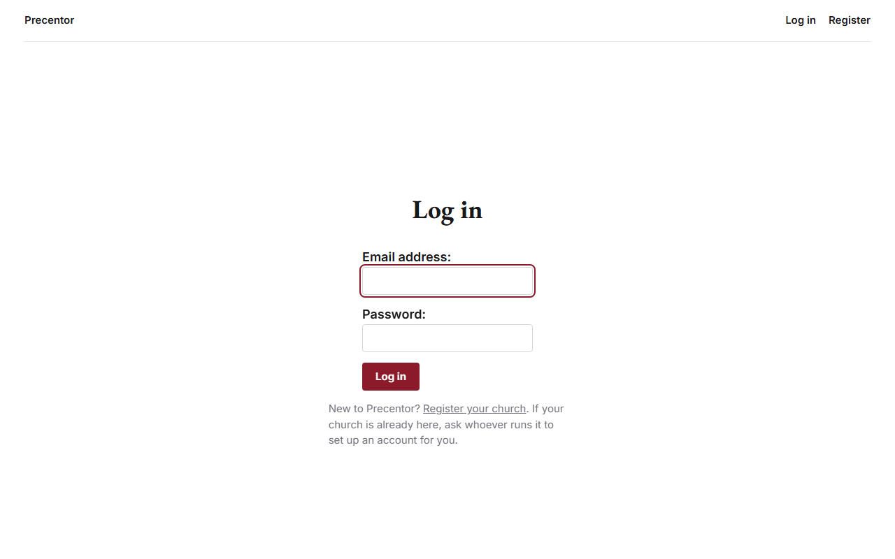

_Figure 1. Signing in by email. New visitors follow the link to register their church._

<a id="figure-2"></a>

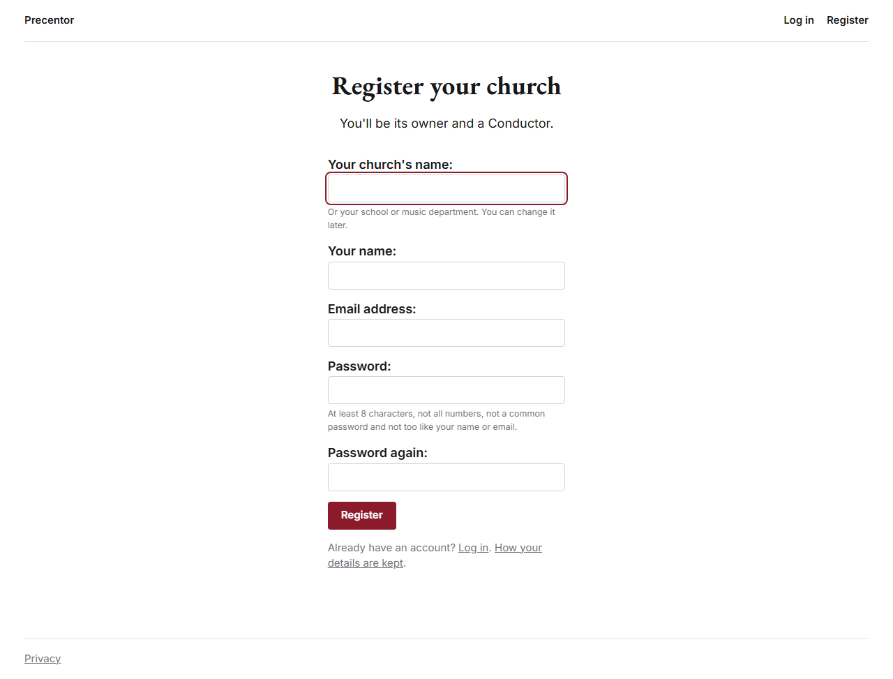

_Figure 2. Registering a church: the person who registers becomes its owner and a Conductor._

<a id="figure-3"></a>

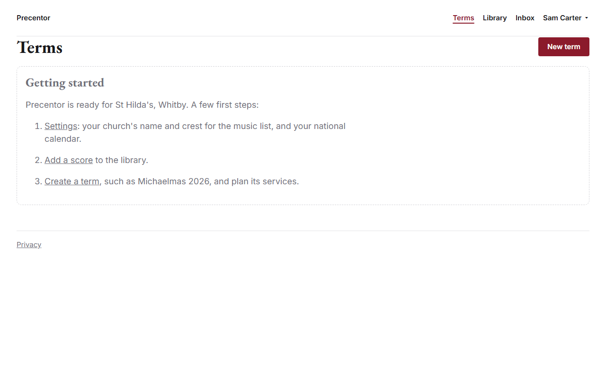

_Figure 3. A new church's first steps, shown until it has a term or a score._

[↑ Back to contents](#contents)

## 3. Core Domain Concepts

The interface uses the words a choir uses, and two of them differ from
the model names in the code:

| In the interface | In the code   | What it is                                      |
| ---------------- | ------------- | ----------------------------------------------- |
| Slot             | `ServiceRole` | A place in a service for music, e.g. Introit    |
| Notice           | `TermMarker`  | A dated line on the music list, e.g. Half term  |

I kept the model names, because renaming them would rename database
tables without changing anything for the people using the app. Each
field's label is set once on the model with `verbose_name`, so the
forms and the admin both show the interface word.

### 3.1 Score

A piece of music in the library. Its fields cover the title, the
composer (surname and other names), any arranger and editor, the
voicing as printed (SATB, SSATB, unison and so on) with a count of each
voice part, the **language**, the number of copies owned and where
they're filed, the duration, background and interpretation notes, and
a vocal range for each part. Scores can be tagged with the uses,
seasons and occasions they suit.

**In the app.** The librarian adds scores, finds them again with search and filters, and keeps each one's details up to date. The filters are Language and Voicing, and Season, Use and Occasion for what a score suits; each lists only what the library has, with a count, and choosing several shows the scores that match them all.

<a id="figure-4"></a>

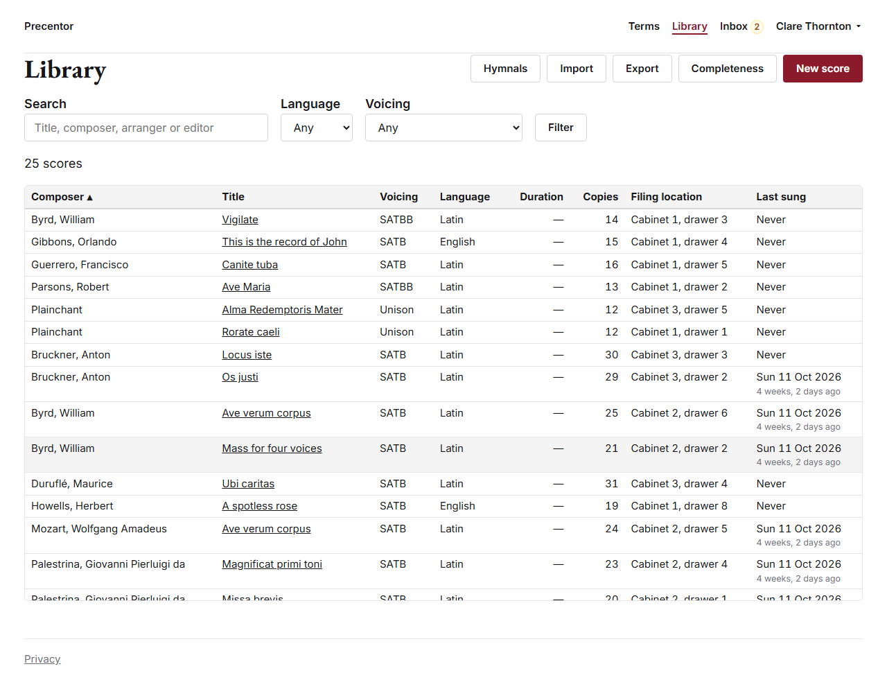

_Figure 4. The library filtered to music suited to Advent: the Season menu set to Advent, and its six scores._

<a id="figure-5"></a>

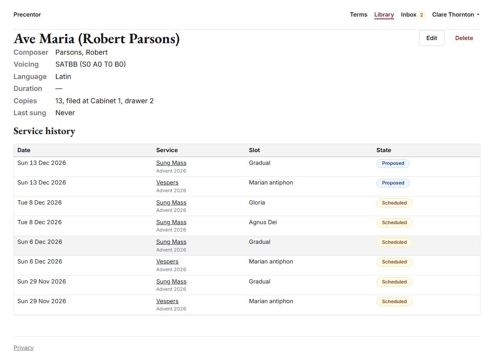

_Figure 5. A score's own page, with its details and where it has been used._

<a id="figure-6"></a>

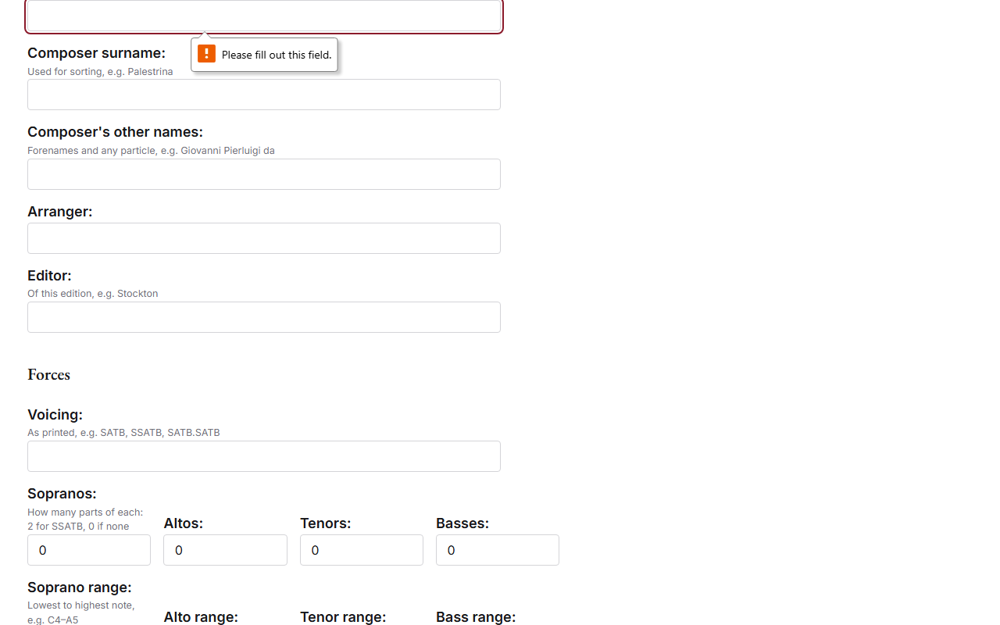

_Figure 6. Adding a score: each missing field is named beside the box that needs it._

<a id="figure-7"></a>

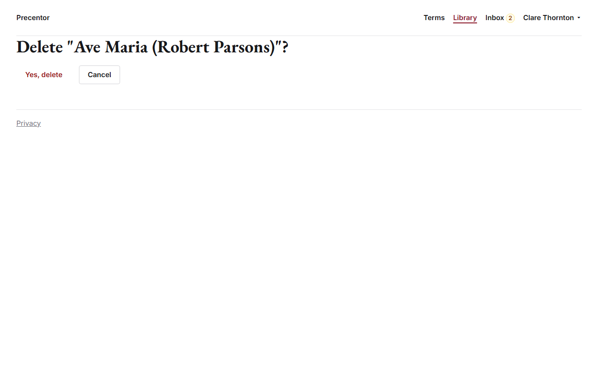

_Figure 7. Deleting always asks first._

**Bringing a library in, and taking it out.** Most churches already keep
their library in a spreadsheet, and typing hundreds of scores in again
would put them off before they started. Import, on the Library page,
explains Precentor's format, offers a template with the right headers
and shows three example rows. Only the title and the composer's surname
are needed. A library kept in Google Sheets doesn't have to be
downloaded first: with the sheet shared as "anyone with the link can
view", its link can be pasted instead of choosing a file. The file is checked before anything is saved: a row that
breaks the same rules as the score form is skipped, with its row number
and the reason; rows that look like scores the church already has are
pointed out but kept, as a church may own two editions; and the result
page says how many scores still have no voicing, with a link to them.
The import then waits, with a notice on the Library, until it's kept or
removed as a whole. Removing it deletes its scores again, except any
already planned into a service. Export, beside Import, downloads the
whole library in the same columns, so it can be kept as a copy, tidied
in a spreadsheet and brought back in.

<a id="figure-8"></a>

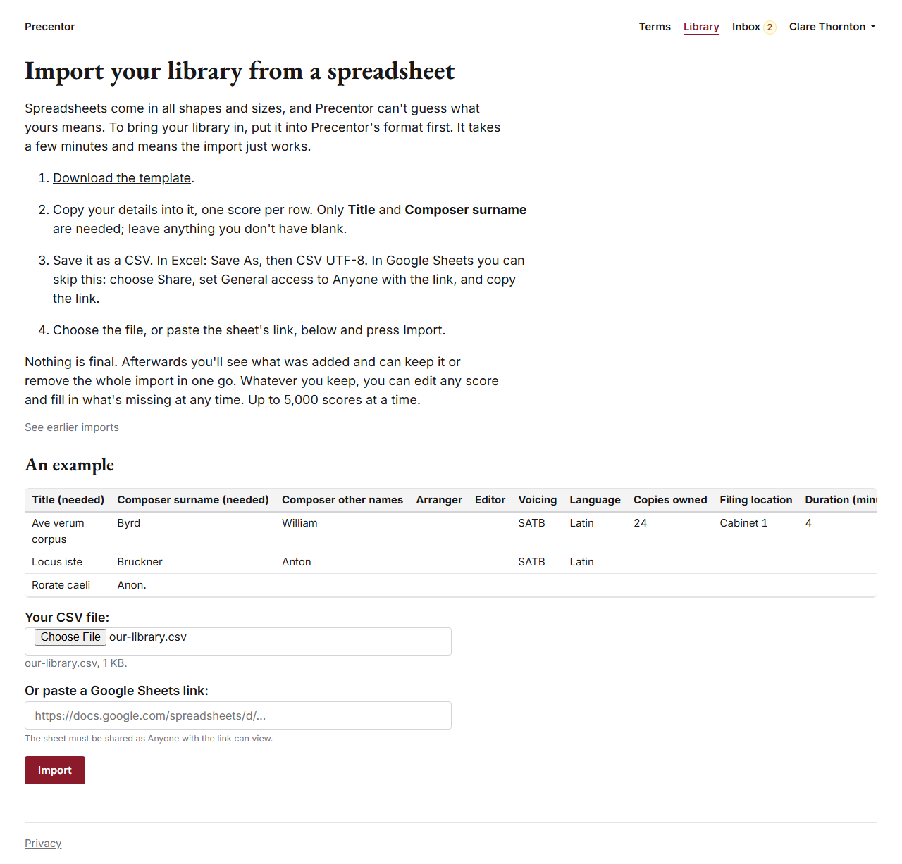

_Figure 8. Importing: the steps, an example of the columns, and the chosen file's size before it uploads._

<a id="figure-9"></a>


_Figure 9. What an import brought in, listed score by score, what it skipped and why, and the choice to keep or remove it._

**Texts.** A score can also hold the words it sets, a translation and
who made the translation, for the pew sheet ([§4](#4-the-public-music-list)). The score's page
shows the text and translation side by side. They're typed by the
church, and the form asks for only texts it's entitled to reproduce:
the liturgical Latin is public domain, but many translations aren't.

**Library completeness.** A page linked from the Library counts the
scores with no voicing and with no language, each count linking to the
Library's own filter so the numbers agree, and lists the scores planned
as a motet or antiphon that have no text yet. None of it is required,
and a count of nothing reads as done.

<a id="figure-10"></a>

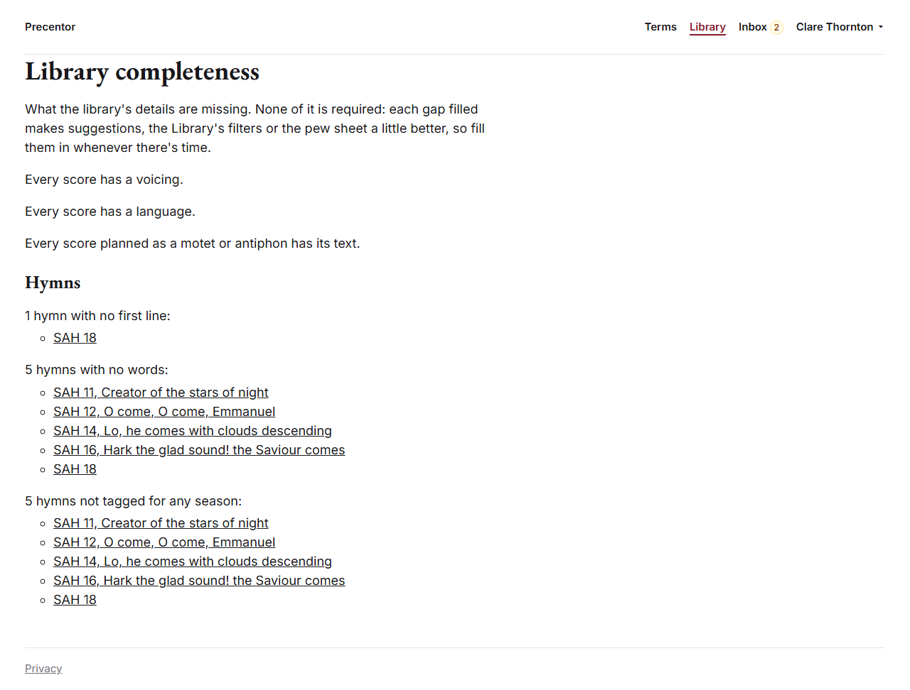

_Figure 10. Library completeness: what's missing, with nothing required. The demo's scores are all complete, so only its hymns are listed._

### 3.2 Term, Service, and Slots

A **Term** is a named container with a date range (e.g. "Lent 2027").
Any number of terms can be open at once, and the app makes no
assumption about which one is "current": the Terms page shows them by
date, and today's date makes it obvious which ones matter now. (An
earlier idea of an explicit "active term" flag was dropped, because it
would have duplicated information the dates already provide.)

A **Service** belongs to a Term and has a date, a type (Sung Mass,
Vespers, etc.) and a liturgical occasion (see [§3.4](#34-ordo-the-liturgical-calendar)).

Each service is made up of musical **slots**, added per service:
a Sung Mass might have a _Mass setting_, an _Introit_, an _Offertory
motet_ and a _Communion_; Vespers might have a _Magnificat_ and a motet.
Slot names are free text, because practice varies from church to
church. One choir sings the Propers, another sings a hymn in place of
some of them, and another adds a motet at the Offertory, or sings one
in place of the Responsorial Psalm when the text is the same. Slots can
be added, removed, or marked **N/A** service by service (a special day
might need an extra motet, or have no setting at all, as on Good
Friday).

Each slot has a **kind**: Proper, Ordinary, Hymn, Psalm, Canticle,
Antiphon, Responsory, Motet, Organ or Other, shown as a small badge beside its name.
The kind is worked out from the name when the slot is added (Introit is
a Proper, Kyrie the Ordinary, Communion hymn a Hymn, Opening voluntary
Organ), and it can be chosen when adding a slot or changed on any slot
later. That matters because practice varies: a church that sings a
hymn at the Introit keeps the slot called Introit and shows it as a
Hymn. A Proper slot also knows which proper it is (Introit, Gradual,
Alleluia or Tract, Sequence, Offertory, Communion).

**The day's chant.** On a service with an occasion, a Proper slot
offers that day's chant beneath its search box, by its
opening words: "Populus Sion" for the Introit on the Second Sunday of
Advent. One click proposes it as a reference, never confirmed, and it
isn't offered again once it's there. An Alleluia or Tract slot takes
whichever the date calls for, so a saint's day after Septuagesima
offers its Tract, and in Eastertide its Alleluias. The names come from
[Divinum Officium](https://github.com/DivinumOfficium/divinum-officium)'s
Mass files, whose names are the very keys Ordo gives 1962 days, so each
day's chants line up with no matching by name (see
[`tools/calendar_export/README.md`](tools/calendar_export/README.md)).
They cover 688 days; commemorations have no Mass of their own, and the
nine England and Wales feasts aren't in Divinum Officium, so those offer
nothing.

**Days with more to sing.** Some days have several chants where most
have one, and Precentor offers all of them in the order they're sung.
Palm Sunday has its procession's antiphons, hymn and responsory; Ash
Wednesday and Candlemas their own antiphons and responsories; Holy
Week's Mandatum antiphons, the Good Friday chants and the Easter Vigil's
canticles; and in 1962 the Ember days have a Gradual after each of
their extra readings. An Antiphon, Responsory, Hymn or Canticle slot is
offered the day's chants of its kind, and a Gradual slot all the day's
graduals. A chant goes from the list once it's proposed in a slot of
the same kind, so a church that wants two antiphons adds two Antiphon
slots and the second offers what the first hasn't taken. There's no
procession kind: where a slot sits in the service already says what
it's for, and its kind says what's sung. The Easter Vigil's one
Alleluia or Tract slot offers both, in the order of the form: the
Tracts first in the Ordinary Form, the Alleluia first in 1962.

For the Ordinary Form the chants are the Graduale Romanum's (1974) for
Sundays and the major feasts, read from the Church Music Association
of America's table of them (see
[`tools/calendar_export/README.md`](tools/calendar_export/README.md)), with a few the table leaves out added from the Graduale
itself. Holy Week is included, read from the same table as the
Sundays. Christmas has four Masses, each with its own propers (the Vigil
Mass, and the Masses during the Night, at Dawn and during the Day), so
each is an occasion of its own, listed on 24 and 25 December with the
day's celebration, and a service is given the one it is. Some Sundays have a chant for one year of
the three-year cycle, such as the Holy Family's Year A Communion,
"Tolle puerum", or a Lent Sunday's Communion for the Gospel read that
year, and Precentor works out which year a service falls in. As in
1962, a weekday with no Mass of its own sings the Sunday before's
propers, so a service on a plain weekday of Ordinary Time, of Advent
up to 16 December, or of Eastertide after its octave is offered that
Sunday's chants. Lent's weekdays, the last days of Advent, the octaves
and most saints' days have Masses of their own that the table doesn't
cover, so they offer nothing rather than the wrong chants. In the Ordinary Form the Graduale's chants are one choice among
several, so a suggestion is only ever a suggestion.

<a id="figure-11"></a>

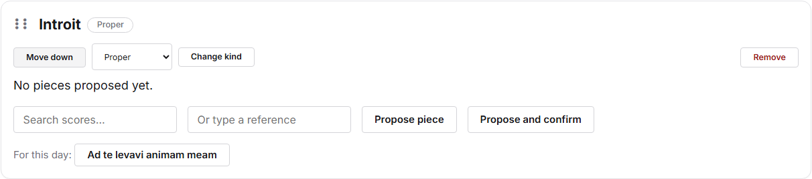

_Figure 11. The 1962 Missal's Introit for the First Sunday of Advent, offered in one click on an empty Proper slot._

<a id="figure-12"></a>

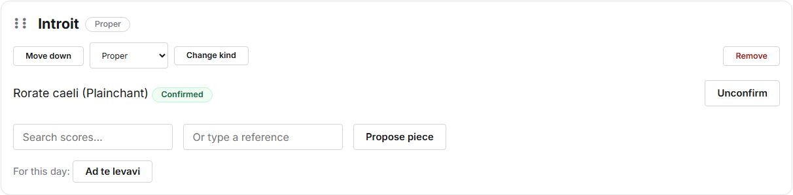

_Figure 12. The same Sunday in the Ordinary Form: the Graduale's Introit is still offered beside the piece already chosen._

A piece in a slot is one of three things: a score from the library, a
**hymn** by its book and number, or a short **reference** typed in, such
as "Psalm 150, tone 4", because psalms and chant are rarely in a
church's library as scores. In Hymn slots the book and number come
first, in Psalm and Antiphon slots the reference box, and elsewhere the
score search. Hymns and the psalm were once typed into two boxes on the
service form and printed beside the music list; they're ordinary slots
now, proposed and confirmed like everything else.

**Hymns, hymnals and tunes.** A church's hymn books are library entries
too, with copies and a filing location, listed from the Library and
archived rather than deleted once hymns have been sung from them.
Nothing about hymns comes with the app: no lists of numbers, tunes or
words. They build up through use. The first time someone plans NEH 53,
Precentor makes an entry for it, and its first line, words, metre and
"suitable for" tags can be added whenever someone knows them, nudged by
a quiet line on the service until they are. A hymn is the text and an
entry is its number in one book, so the same hymn sung from two books
counts as one for "last sung" and suggestions, once someone confirms
that they're the same: a hymn whose first line matches another's asks.

A church that already keeps a book's numbers in a spreadsheet can
import the list from the hymnal's page, from a file or a Google Sheets
link: a number, and optionally its first line, metre and tune. New
numbers come in as entries; for numbers the book already has, only
blank details are filled, so nothing typed by hand is overwritten. As
with scores, the import waits to be kept or removed as a whole, and
removing it takes out what it added (unless sung) and empties what it
filled in.

A Hymn slot suggests a handful of hymns suited to the day, each with its
reasons, and one click fills in the book and number. Hymns have their
own "sung recently" window on Settings, six weeks to start. Once a hymn
is in a slot, its row offers the tune to sing it to: the book's own,
then tunes in the same metre the same book prints, then any other the
church knows. Metres are written one way whatever is typed, so "LM" and
"88 88" match. On the pew sheet a hymn prints as its number, and a tune
from elsewhere in the same book by that tune's number, "NEH 53, tune
NEH 115", so someone can keep a finger in the music.

<a id="figure-13"></a>

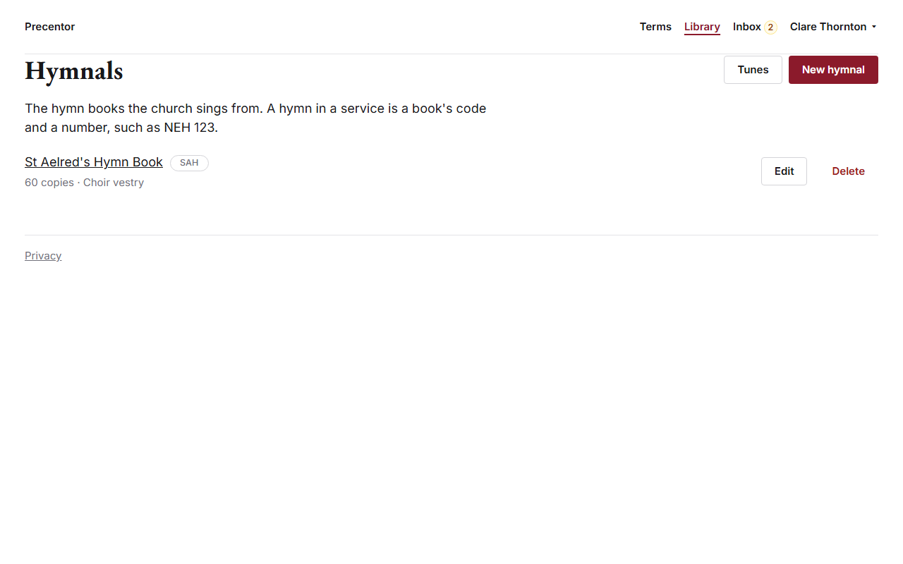

_Figure 13. Hymnals: the church's hymn books, as library entries with their copies and where they're kept._

<a id="figure-14"></a>

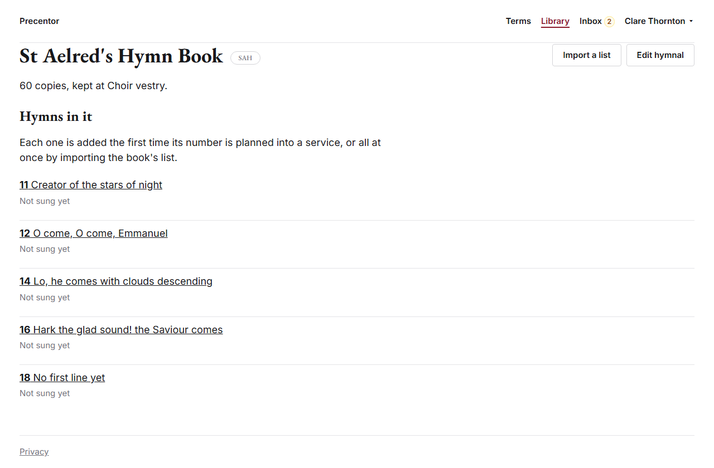

_Figure 14. A hymnal's page: its hymns in number order, added as they're planned or imported as a list._

Each slot has its own **Remove** button. An empty slot goes straight
away; one with pieces proposed asks first, saying how many pieces go
with it, because those pieces and their comments are deleted too.

Each **piece** has a Remove button too, beside Confirm, for a proposal
that was wrong or has been replaced. A proposed piece with no comments
goes at once. A confirmed one asks first, because it will leave the
music list, and so does one with comments, which go with it. The
slot's form is sent back with the change, so a chant taken out is
offered again, and without JavaScript the question is a page of its
own.

Slots keep the order they're given, and a new one goes at the end, so
they can be **moved**: dragged by the handle beside the name, or moved
with the Move up and Move down buttons, which work from the keyboard,
on a phone and without JavaScript. While a slot is being dragged,
holding it near the top or bottom of the window scrolls the page, so a
motet can be carried from the end of a long Mass to anywhere in it.

**Slot templates** save adding the usual slots one by one. On a
service's page, a button per template adds its slots in order: **Mass**
(Introit, Kyrie, Gloria, Gradual, Alleluia or Tract, Credo, Offertory,
Sanctus, Agnus Dei, Communion), **Mass with hymns** (an entrance,
offertory, communion and recessional hymn in place of the propers, with
the psalm and Alleluia) and **Vespers** (Psalms, Hymn, Magnificat,
Marian antiphon) come ready-made, and a conductor can edit those or
make their own, such as Benediction or a choir's usual Sunday Mass with
its motets. A template lists its slots as rows, each with its kind and
proper part, so a slot added from it arrives already classified, and a
church that sings a hymn at the Introit says so once, in the template. A service uses one template at a time: choosing
a different one asks "Replace the Mass slots with Vespers?" first, then
removes the old slots and adds the new. Any slot with pieces proposed
is kept, so no planning is lost. Applying the same template twice
changes nothing, and afterwards the slots are ordinary slots, to move,
mark N/A or remove like any other.

<a id="figure-15"></a>

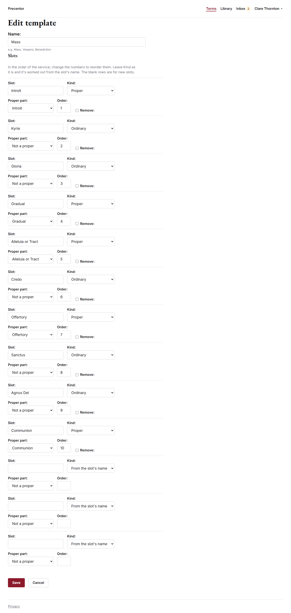

_Figure 15. Editing a template: each slot keeps its kind and proper part, and the blank rows add new ones._

**In the app.** The conductor plans a term on the Terms page, opens it to see every service and its status, and opens a service to fill its slots.

<a id="figure-16"></a>

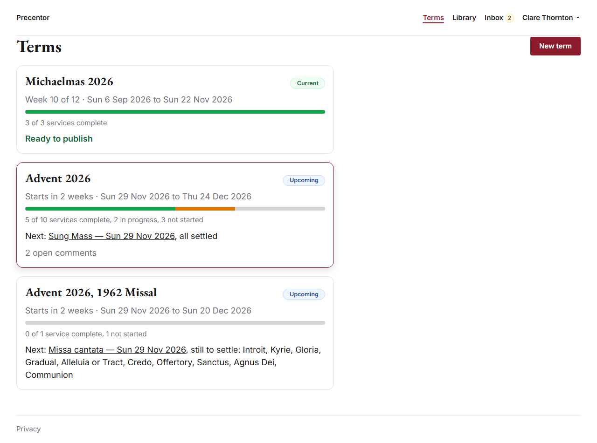

_Figure 16. The Terms page: each term's progress at a glance._

<a id="figure-17"></a>

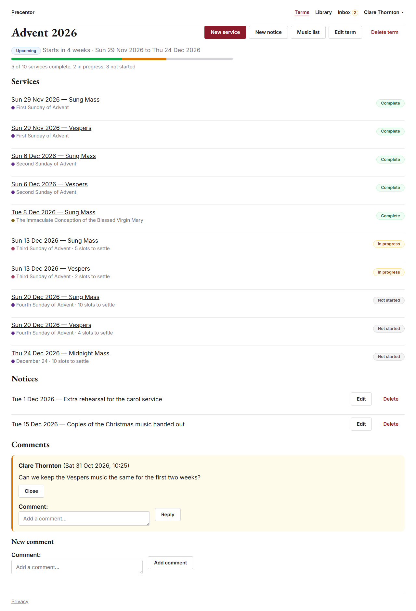

_Figure 17. A term: its services in date order with their status, its notices and its comments._

<a id="figure-18"></a>

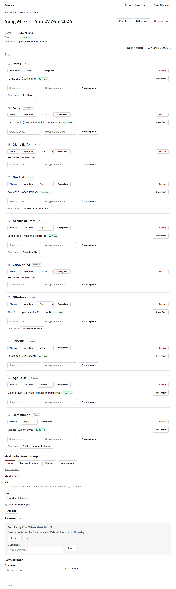

_Figure 18. A service: the occasion worked out from its date, slots added from the Mass template with each one's kind, confirmed pieces and two slots marked N/A._

### 3.3 Proposing and Confirming

Each slot holds a **shortlist of proposed pieces** (e.g. two motets
still being weighed up). Confirmation happens **per piece**, not per
slot or per service, which allows cases like two motets in one service,
or a mixed setting. A confirmed piece can always be **unconfirmed**
again; nothing is a one-way door. Where there's nothing to weigh up,
**Propose and confirm** does both in one step.

Pieces are proposed from a search box in each slot, which lists the
whole library in groups: **Suggested**, then **Suggested, sung
recently**, then the other scores, with any sung recently last of all.
A score is suggested when it's tagged for the service's occasion, its
season, or the slot's use (a use type named like the slot, such as
Communion, or like its kind, such as Motet), and the occasion counts
for more than the season, the season for more than the use. Each
score says why in a short line under its name: "For Advent", "Last
sung 14 weeks ago", "Already planned this term". Nothing is ever left
out of the list: suggestions only reorder it and explain, because the
tool can't know that an untagged score won't suit. Without JavaScript,
each slot has a "Propose a piece" link instead, which opens a short
page with the same groups and reasons in one list. That keeps the
service page small: it carries the library once, not once for every
slot.

Music the library doesn't hold, such as a setting borrowed for one
Sunday, can still be proposed. When a search finds nothing, the list
offers the text as typed, and it goes in as a reference. In a slot
that usually holds a score (an Ordinary, Motet, Organ, Canticle or
Other slot) the piece then says quietly "Not in the library", and
anyone who can edit the library gets a link to the score form with the
title filled in. Adding the score doesn't change the piece already
proposed: it stays a reference unless it's proposed again.

Marking a slot **N/A** counts as a planning decision, just as
confirming does. It means "I've considered this and there's nothing
here on purpose", not "nothing has happened yet".

A service's overall status is **derived**, not stored:

- **Not started**: no candidates anywhere
- **In progress**: some slots still only have proposed (unconfirmed) pieces
- **Complete**: every slot is either confirmed or marked N/A

This status powers the Terms page's overview, so a conductor can scan a
term and see at once which services still need attention.

**In the app.** Typing in a slot's search box lists the library in its groups, each score with its reasons. Choosing one proposes it; Confirm settles it, or Propose and confirm does both at once. A score with no voicing says so quietly on its row, with a link to add one that comes back to the service afterwards.

<a id="figure-19"></a>

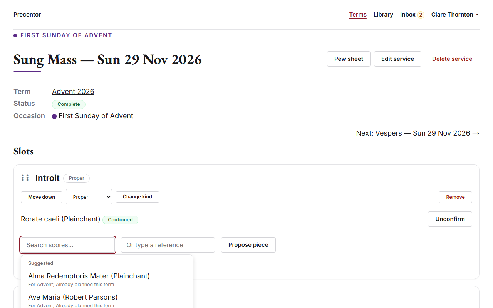

_Figure 19. Proposing a piece from the slot's search box: on an Advent Sunday the season's scores are suggested first, each with its reasons._

### 3.4 Ordo (the Liturgical Calendar)

**Ordo** is this project's name for its liturgical calendar engine. It
follows the Roman calendar: Advent, Christmas, Ordinary Time, Lent, the
Easter Triduum and Easter, with Ordinary Time resuming after Pentecost.
Some occasions are fixed-date (Christmas Day), others are moveable,
calculated relative to Easter (Ash Wednesday, Palm Sunday, Pentecost).
Each term follows either the Ordinary Form or the 1962 Extraordinary
Form calendar, and a single service can override its term's choice,
since some choirs sing both. Services carry a liturgical occasion drawn
from Ordo, which drives both the ranking of suitable scores and the
seasonal colour used in the interface.

Ordo holds the real calendars, not a sample:

- **Both forms.** The Ordinary Form's Sundays, solemnities, feasts,
  obligatory memorials and privileged weekdays, and the 1962
  calendar's days of the first three classes. Optional memorials and
  fourth-class days are left out: a choir is very unlikely to sing for
  one.
- **The church's own country.** On Settings, a conductor chooses the
  General Roman Calendar, England or Wales. England keeps St George as
  a solemnity, for example, and moves Corpus Christi to the Sunday;
  Wales keeps St David. The 1962 calendar has England's and Wales's
  days too.
- **Precedence.** When two days fall together, Ordo works out which is
  kept, by the Church's own tables: a solemnity on a Sunday of Easter
  moves to the Monday, a memorial in Lent is kept only alongside the
  weekday, and in 1962 a feast may be commemorated instead. It works
  this out for any year, from rules, not from a list of dates.
- **Suggestions.** When a service's date is entered, the service form
  suggests the day's celebration, and anything also kept that day, for
  the conductor to choose.
- **One form at a time.** The calendar comes first on the service
  form, and the occasion lists below it then show only that form's
  days, which roughly halves what there is to search. An occasion
  already chosen stays listed whichever form is picked, and without
  JavaScript both forms are listed, with the 1962 days marked "(1962)".

The rules are ported from two open-source projects, romcal (the
Ordinary Form) and Missalemeum (1962), and checked against them for
every day from 2020 to 2040; England's and Wales's 1962 days come from
the Latin Mass Society's Ordo. Where Precentor's answer differs from a
source, the reason is recorded.
[`docs/calendar_plan.md`](docs/calendar_plan.md) has the design and
the checks, and [`docs/acknowledgements.md`](docs/acknowledgements.md)
how each source was used.

### 3.5 Rehearsal Lead-Time (dropped)

An early plan gave each score an optional rehearsal lead-time tag: how
far ahead a piece needs to go into rehearsal, as a more useful signal
than a subjective "difficulty" rating. I dropped it before the build
was finished, because nothing else in the app used or showed it, and it
added a rehearsal-scheduling question the tool doesn't otherwise ask.

### 3.6 "Last Sung"

Derived from service history: the most recent service, on or before
today, in which the piece was confirmed. A piece confirmed for a
future service is scheduled, not sung, so it doesn't count yet. Like a
service's status, it's worked out when the page loads and never
stored, so it can't fall out of step with the planning data.

A choir's history starts long before it begins using Precentor, so
each score can also carry a manual "last sung" date for older records;
the library shows whichever date is later. The library table shows it
as a date with a rough interval ("Sun 4 Oct 2026, 3 weeks ago"), or
"Never". The score's own page lists its **complete history**, every
service it has been proposed or confirmed for, which helps a librarian
or conductor check how often something has been repeated. The same
piece can fill several slots, or repeat across different services and
terms.

When pieces are suggested, a score sung within the church's **repeat
window** (eight weeks unless Settings says otherwise) moves below the
others and says when it was sung. It isn't hidden: sometimes a piece
is repeated on purpose.

[↑ Back to contents](#contents)

## 4. The Public Music List

Modelled on a real example (a termly printed list from a parish
church), the tool produces a formatted document from a term's current
state:

- **Snapshot, not live.** The printed list shows the state at the
  moment it was printed. If things change afterwards (as they sometimes
  do, right up to the day), the printed or shared copy reflects what
  was true then; the app doesn't try to keep copies in step after the
  fact.
- **Latest version only.** The app doesn't archive past versions. Once
  a list has been shared or printed, its life belongs to whoever
  received it; the app is only concerned with "now".
- **Partial lists are allowed.** A term still in progress can produce a
  useful internal draft. In the draft, a slot without a confirmed piece
  is marked **TBC**, so nobody confuses something left out on purpose
  (N/A) with something not yet decided. The distinction matters,
  because a public document should never show an undecided choice as
  if it were settled; the public version leaves those slots out.
- **Newspaper columns by default.** Following the same real example,
  the public list flows its entries down one column and on to the top
  of the next (CSS `columns`, not a hand-built grid), with each
  service's occasion alongside it. A site-wide setting can switch this
  to a plain single column instead, and another prints each service's
  propers beside the rest of its music rather than in service order. The draft always
  uses the simple layout, since it's for spotting what's still TBC, not
  for final presentation.
- **Notices alongside services.** A **notice** puts free text on a
  given date (e.g. "Choir resumes services on 22nd February") in the
  same timeline as the services, for something like half term or a
  retreat that isn't a service with slots of its own.
- **Branding set once.** A single site-settings record (church name,
  crest, house accent colour, and the layout and arrangement
  settings above) is set on a conductor-only page and applied to every
  music list, so the details aren't re-entered each term. The crest can
  be a logo, shown at its own shape beside the church's name, or a
  banner across the top that carries the name itself, since churches
  use both. A banner can be cropped in the browser before upload;
  without JavaScript, the raw image can still be uploaded, and the
  server crops it to the same shape instead of rejecting it. The image
  is kept in the database rather than on disk, because a host wipes its
  disk on every deploy.
- **The liturgical accent, reused.** Each entry's left-hand colour
  stripe uses `Service.occasion.colour` in the same way as the service
  page (see [§3.4](#34-ordo-the-liturgical-calendar), and the
  [liturgical accent section](docs/design_system.md#liturgical-accent) of
  [`docs/design_system.md`](docs/design_system.md)), falling back to the
  house accent colour when a service has no occasion of its own.

**In the app.** The music list lays out the whole term for the choir and congregation, with the church's name and crest, and prints on paper. A draft view marks slots still to be decided as TBC.

<a id="figure-20"></a>

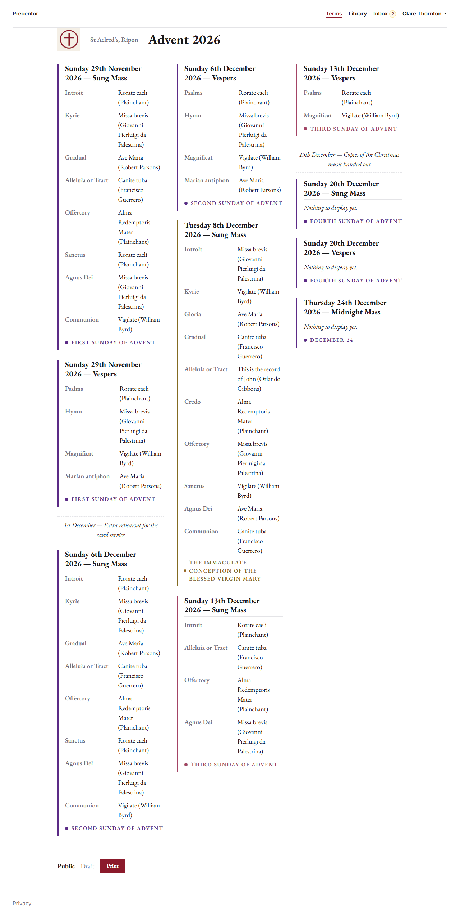

_Figure 20. The public music list for Advent, with Public, Draft and Print at the foot._

<a id="figure-21"></a>

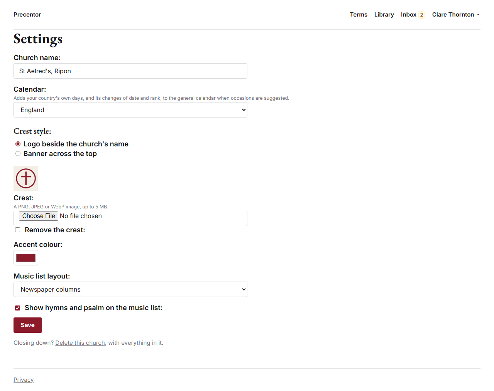

_Figure 21. Settings: the church's name, calendar and crest, how the music list is laid out, and how recent counts as sung recently for suggestions._

**The pew sheet.** Each service also has a sheet for the congregation,
linked from its page for every role. It prints the service's confirmed
music in order: hymns and psalms as their references, other pieces by
title and composer, and each motet's text beside its translation, with
the credit beneath. Texts and composers can be left off with a plain
form whose choices go in the address, so it needs no JavaScript. It
uses the music list's styles, so it prints the same way: white, with
the controls hidden, whichever theme is on.

<a id="figure-22"></a>

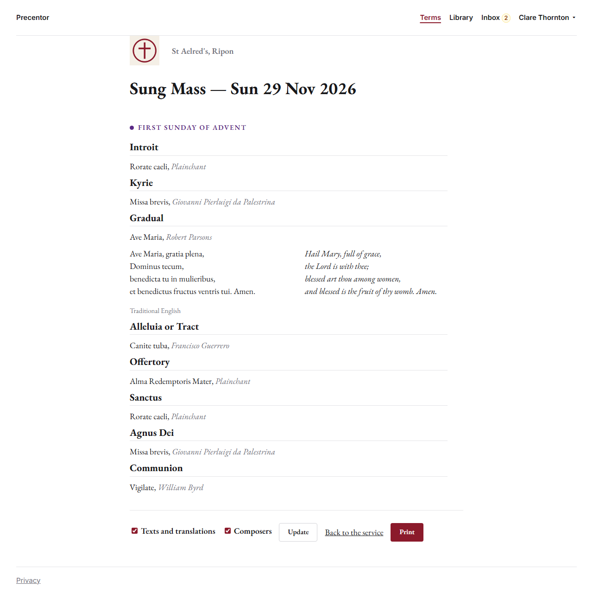

_Figure 22. The pew sheet: the service's confirmed music in order, with a motet's text beside its translation._

[↑ Back to contents](#contents)

## 5. Roles and Permissions, Revisited

The roles mirror how the work is divided: **the conductor decides, the
librarian fulfils.** The librarian owns the physical library, while
repertoire decisions (propose, confirm, unconfirm, N/A) stay with the
conductor alone. The librarian can see all of the planning but change
none of it. A viewer, such as a singer or a clergy colleague, can see
everything and join the discussion in the comments, but changes
nothing.

Every rule lives in one place, `accounts/permissions.py`: one small
function per question ("may this person plan?", "may they edit the
library?"). Views ask through a decorator or a mixin, and templates
through a `can` variable, so a button and the page behind it always
agree. Someone signed in who tries something their role doesn't allow
gets a "403 Forbidden" response, rather than being sent back to the
login page, where logging in again would change nothing. A test holds
the whole table of roles against rules, so the code and this section
can't quietly drift apart.

**Accounts.** People sign in with their email address and a password.
Each person belongs to one organisation (a church, a music department
or a school) and holds one role in it, and one of them is its owner,
who looks after its members. I replaced Django's built-in user with
my own model before the database had any tables, because Django can't
swap user models once they exist. The database itself refuses accounts
that make no sense: someone in an organisation without a role, an
owner outside one or who is only a viewer, or a second account for the
same address typed in different capitals. Addresses are stored in
lowercase and sign-in ignores case, so `Anne@Example.com` and
`anne@example.com` are one person. A site superuser belongs to no
organisation and gets no powers inside the app; the admin pages are
theirs.

**Registering a church.** Anyone can register their church from the
login page. They give its name, their own name, an email address and a
password, and become its owner and a Conductor, already signed in. The
church starts with its own copies of the Mass and Vespers templates and
the use types Mass, Vespers and General, which it can change without
touching anyone else's. Until it has a term or a score, the Terms page
shows a few first steps, each only if the person's role allows it.
The owner then invites everyone else from the Members page.

**Leaving.** Anyone but the owner can delete their own account, after
giving their password; their comments stay, credited to "A former
member". The owner can delete the whole church, after typing its name,
which deletes everything in it and every member's account. A privacy
page, linked from every page's footer, says what's kept and how to have
it deleted.

**Keeping churches apart.** Every church's scores, terms, services,
templates, use types, comments and settings carry their organisation,
and every page looks only within the signed-in person's own. Someone
who types the address of another church's score or service gets a
"404 Not Found", as if it didn't exist, rather than a "403 Forbidden"
that would admit it does. The liturgical calendar is the one thing
every church shares. A test tries every address in the app as another
church, and checks every page for anything of the other church's, so
it stays true as pages are added.

**In the app.** The owner invites people from the Members page. The link is shown once, to send by hand, and the new member joins in the role it names. Anyone without a permission sees a plain explanation, and another church's records simply don't exist for them.

<a id="figure-23"></a>

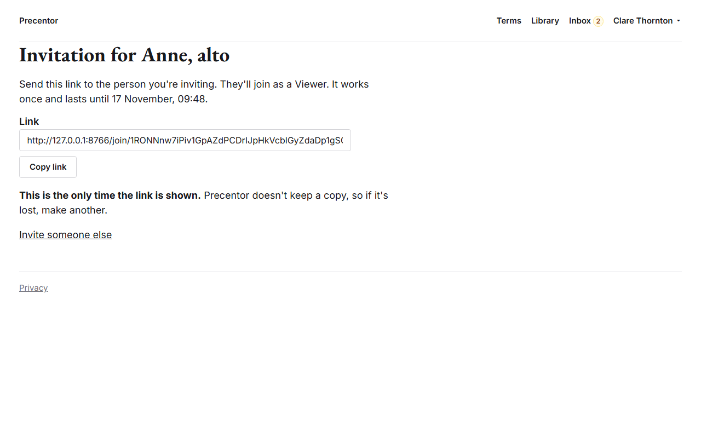

_Figure 23. An invitation link, shown once for the owner to pass on._

<a id="figure-24"></a>

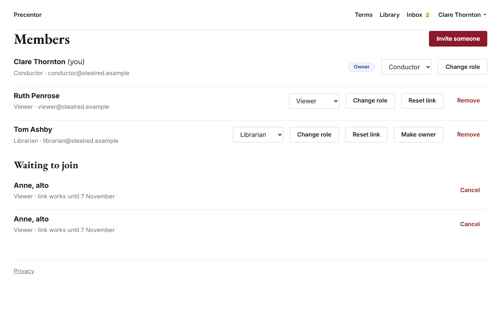

_Figure 24. The Members page as the owner sees it._

<a id="figure-25"></a>

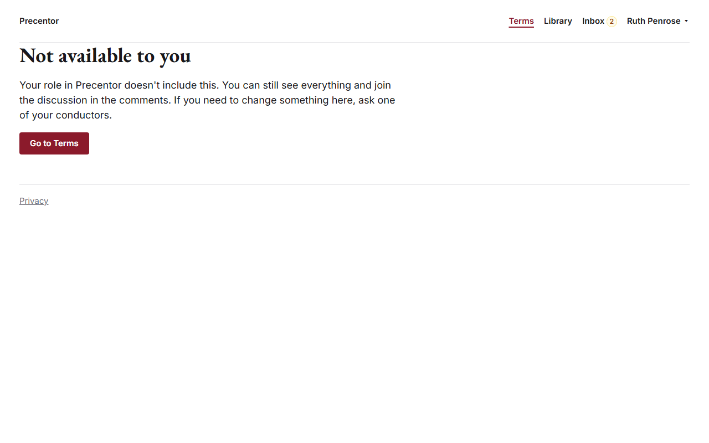

_Figure 25. A Viewer trying to create a term gets a 403 page that says why._

<a id="figure-26"></a>

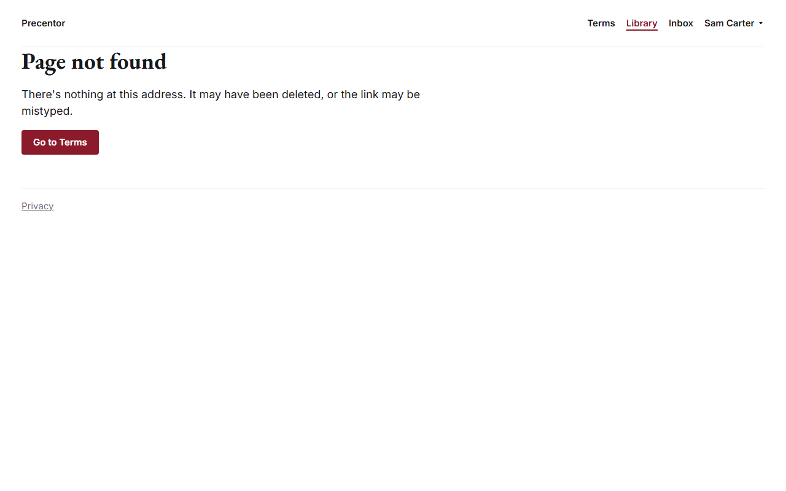

_Figure 26. Someone from another church opening this church's score by its address gets a 404, as if it didn't exist._

[↑ Back to contents](#contents)

## 6. Comment Threads

A small, bounded feature that lets the librarian and conductor discuss
things without leaving the app:

- **Flat structure:** one layer of comments, with replies underneath and
  no nested threading.
- **Authored:** each comment shows its author's name.
- **Open or closed,** and anyone can close or reopen a thread. Only a
  conductor or librarian can delete one, and only once it's closed, so
  a viewer can't erase a discussion other people took part in.
- **Three colour states:** open, open with replies, and closed.
- **Targets:** each service and each term has a comment thread ("is
  this service's shape right?" against "how's this term looking
  overall?"). A question about a particular piece ("do we have enough
  copies of this?") goes in its service's thread; I decided a separate
  thread per piece would be more granular than the conversation needs.
  The link is a single polymorphic relationship (Django's
  `GenericForeignKey`, via `contenttypes`) instead of separate optional
  foreign keys. That keeps the `Comment` model clean, at the cost of
  database-level joins, which is an acceptable trade-off for a "should
  have" feature. The model would still accept a comment on a piece if
  that were ever wanted.
- **Inbox:** every open comment, with no read receipts or @mentions. In
  a close-knit working relationship of two or three people, routing
  attention would be needless complexity.
- Comments share their subject's lifecycle: if a service is deleted,
  its comments go with it. That's a simple default chosen on purpose,
  not an oversight.

This remains a **"should have"**, not core to the MVP.

**In the app.** Open threads from every service and term collect in the Inbox, and the number in the menu shows how many are waiting.

<a id="figure-27"></a>

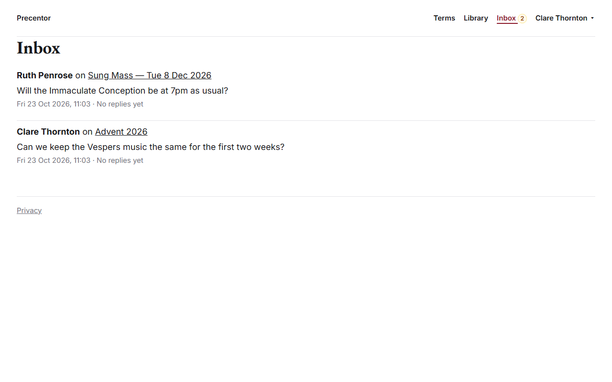

_Figure 27. The Inbox of open threads._

[↑ Back to contents](#contents)

## 7. Scope Discipline (MoSCoW)

Each item says whether it's built. Only the last two nice-to-haves
aren't.

**Must have (the spine)**

- Score CRUD (title, composer, arranger, voicing, language, duration): built
- Term → Service structure, with slots per service: built
- Filter scores by voicing: built
- "Last sung" derived from service history: built
- Basic liturgical season tagging and filtering: built
- Churches that register themselves and see only their own data: built

**Should have**

- Full Ordo (Roman liturgical calendar, Ordinary and Extraordinary Form) with moveable feast calculation: built
- Filter by language: built
- Physical copy tracking (copies owned, filing location): built
- Conductor, Librarian and Viewer roles with distinct permissions, and an owner who invites people: built
- Comment threads: built
- Bulk CSV import of a legacy library, with an export in the same format: built
- Slots that know their kind (Proper, Hymn, Motet and so on): built

**Nice to have**

- Repertoire suggestions (occasion, season, use type and not sung recently), with the reasons shown: built
- Hymnals, with hymns built up by number as they're used, and tunes: built
- Importing a hymnal's list, kept or removed as a whole: built
- Score texts and translations, and a pew sheet: built
- Templates whose slots keep their kinds: built
- The day's chants offered on Proper slots: built, for the 1962 Missal and for the Ordinary Form's Sundays and major feasts
- CCLI/copyright licence reporting export: not built
- Choir roster awareness (auto-filtering by available voice parts): not built

[↑ Back to contents](#contents)

## 8. Out of Scope

- One account belonging to several organisations. Each person
  belongs to one church; someone who sings in two would need two
  accounts.
- Calendars other than the Roman one, such as the Church of England's
  Common Worship and Book of Common Prayer. Precentor originally
  modelled the Catholic and Church of England calendars side by side,
  with a tradition chosen per term. I narrowed it to the Catholic
  calendar because one church follows one tradition, so a per-term
  choice added a field to every form, a second set of seed data and a
  second set of tests without helping any real user. A second tradition
  remains possible future work, most simply as each church's own setting, not
  a per-term choice.
- A history or archive of past music lists.
- An "active term" flag (the dates already show which term is current).
- Nested comment replies.
- Precise double-choir voicing (e.g. which parts belong to which of two
  choirs). It's recorded accurately in the free-text voicing field, but
  not as structured data that can be searched.
- Per-slot permissions, e.g. a parish secretary who can edit only a
  "Hymns" slot while the conductor controls the Mass setting and
  motets. In some churches hymn choice does sit outside the conductor's
  remit, but modelling that would mean permission checks keyed to
  individual slot names instead of a fixed Conductor and Librarian
  split, a much bigger structural change than the MVP calls for. The
  three roles (Conductor: full access; Librarian: the library, with
  planning read-only; Viewer: read-only, apart from comments) cover the
  common case.
- Ordo as a liturgical reference tool. Ordo's job is to name, date and
  colour occasions, for ranking repertoire and labelling services. It
  doesn't model readings, psalms or rubrical detail (e.g. whether the
  Gloria is said), and of the propers it holds only the chants' opening
  words (the next item), even if it later covers other calendars.
  That's a separate, mature domain with authoritative tools already
  serving it well, and duplicating it would mean building a different
  application inside Precentor.
- Anything beyond the chants' names. Precentor offers each day's
  chants by their opening words ([§3.2](#32-term-service-and-slots)), never full texts, translations
  or music, and for the Ordinary Form only Sundays and the major
  feasts.
- Hymnal contents. Precentor ships no hymn numbers, first lines, tunes
  or metres. A church's hymns build up as it types a book and number
  into a slot, or as it imports its own list for a book, so I copy
  nothing from a published hymnal's index, whose copyright I'm not in a
  position to judge.
- Fully customisable music list layouts (drag-and-drop design, arbitrary
  field order or typography). Precentor ships one default layout and a
  small set of high-value settings (column style, house accent colour,
  crest, arrangement), not an open-ended design tool. A church whose
  house style differs further still has full access to its planning
  data; the limit is only on the built-in printed output.

Each of these is noted here so that scope decisions read as choices,
not oversights, when an assessor reads this document.

[↑ Back to contents](#contents)

## 9. Supporting Documents

[`docs/README.md`](docs/README.md) indexes these, and says which
describe the app as built and which are plans kept as a record.

- [`docs/user_stories.md`](docs/user_stories.md): user stories for the
  conductor, the librarian and the site owner (the church), used to
  check the finished application against its original intent.
- [`docs/erd.mmd`](docs/erd.mmd) (Mermaid source, which GitHub renders):
  the entity relationship diagram for all 23 tables, from churches and
  people to hymns, tunes and the day's chants. Its notes explain what
  it simplifies: a slot template copies its slots into a service, so
  they keep no link to it, and a comment's link to a term, service or
  piece is drawn as three edges, though it's a single Django
  `GenericForeignKey` in the code.
- [`docs/models_plan.md`](docs/models_plan.md): the Django app breakdown
  and field-level model plan that turned the ERD into code. I wrote it
  before scaffolding the project and updated it as the build turned up
  corrections (the fixed-date fix and the colour `choices` decision, for
  example).
- [`docs/design_system.md`](docs/design_system.md): the visual design
  system, covering CUBE CSS, cascade layers (not `@import`), design
  tokens, self-hosted typography and the liturgical accent.
- [`docs/calendar_plan.md`](docs/calendar_plan.md): the design of Ordo's
  real calendars and their order of precedence, what was built, and
  how it was checked against its sources.
- [`docs/ordo_plan.md`](docs/ordo_plan.md): the earlier design of the
  occasion suggestions and the score suitability tags.
- [`docs/score_import_plan.md`](docs/score_import_plan.md): earlier
  designs for importing a library from a spreadsheet, superseded by the
  simpler import I built ([§3.1](#31-score)).
- [`docs/merge_record.md`](docs/merge_record.md): how the work since my
  first submission reached the live site on 10 November 2026, rehearsed
  first on a copy of the live data, and what happened at each step.
- [`docs/overhaul_plan.md`](docs/overhaul_plan.md): the overhaul before
  deployment, phase by phase, with a log of what each phase found.
- [`docs/acknowledgements.md`](docs/acknowledgements.md): every outside
  source I've drawn on (calendar data and rules, liturgical documents,
  design methods, typefaces and packages), what I used from each, and
  its licence.
- [`docs/blocks_backlog.md`](docs/blocks_backlog.md): the running log of
  Blocks found while laying out every page, each built only once the
  same pattern had appeared more than once, instead of being guessed at
  up front.

[↑ Back to contents](#contents)

## 10. Why This Project

Precentor comes from my own experience as a church choral conductor. It
addresses a specific, recurring chore (planning repertoire and
producing music lists by hand) for a clear audience: a conductor working
alongside a librarian or music administrator. Each design decision
above has a concrete reason behind it, drawn from how church music
planning actually works, instead of a generic "library system"
template.

[↑ Back to contents](#contents)

## 11. Acknowledgements

I'm grateful to everyone whose work Precentor builds on. The Ordinary
Form calendar's date rules are a Python port of
[romcal](https://github.com/romcal/romcal)'s (MIT licence), checked
against romcal's own calendars, and its order of precedence follows the
Church's General Norms for the Liturgical Year and the Calendar. The
1962 calendar is a port of
[Missalemeum](https://github.com/mmolenda/Missalemeum)'s rules (MIT
licence), and its days for England and Wales come from the Latin Mass
Society's Ordo. The 1962 Mass chants' names come from
[Divinum Officium](https://github.com/DivinumOfficium/divinum-officium)
(MIT licence; the liturgical texts are in the public domain), and the
Ordinary Form's from the Church Music Association of America's table
of the 1974 Graduale Romanum. The stylesheets follow Andy Bell's CUBE CSS, with layouts based on Every
Layout by Heydon Pickering and Andy Bell, and fluid scales from
Utopia. The typefaces are EB Garamond and Inter, both under the SIL
Open Font License. [`docs/acknowledgements.md`](docs/acknowledgements.md)
lists every source in full, with what I took from each and how, and
my thanks to each.

[↑ Back to contents](#contents)

## 12. Deployment

Precentor runs on [Render](https://render.com), described in full by
`render.yaml` at the root of the repository (a Render "Blueprint"). The
`Procfile` follows the course's Heroku convention, but the deployment
itself is described by `render.yaml`. It creates a project called
Precentor with a Production environment holding:

- **The web service**, on Render's free plan, in Frankfurt. It sleeps
  after 15 minutes without visitors and takes about a minute to wake,
  which is fine for a project with a handful of users. Each deploy
  installs the requirements, collects the static files, runs the
  migrations, makes the cache table if it's missing (it holds the
  counts that limit sign-in attempts) and loads the liturgical
  calendar, then starts the site
  with gunicorn. The free plan has no separate pre-deploy step, so all
  of that happens in the build.
- **The database**, Postgres 17 on the smallest paid plan, because a
  free Render database is deleted 30 days after it's made. Its allow
  list is empty, so only Render's own services can reach it.

The settings read everything a host provides from the environment.
Render generates `SECRET_KEY` and supplies `DATABASE_URL` and the
site's own address, so nothing needs typing into the dashboard. With
`DEBUG` off, the site is served only over HTTPS with secure cookies,
and `manage.py check --deploy` is clean.

To deploy it from a fresh copy of the repository:

1. In the Render dashboard, choose **New**, then **Blueprint**, connect
   GitHub if asked, and pick this repository and its `main` branch.
2. Check the list of what will be created (the project, the web service
   and the database) and apply it. The paid database needs a payment
   card on the account.
3. Watch the web service's log. The build ends with the calendar being
   loaded (lines such as `general_roman: 223 added`), then "Your
   service is live".
4. Make the first superuser from your own computer, since the free plan
   has no shell on Render. Add your IP address to the database's allow
   list, copy its External Database URL, and in the project folder with
   the virtual environment active run:

   ```powershell
   $env:DATABASE_URL = "the External Database URL"
   python manage.py createsuperuser
   Remove-Item Env:DATABASE_URL
   ```

   It asks only for an email address and a password. Then take your IP
   address off the allow list again.
5. Sign in to `/admin/` as the superuser, add an organisation, and add
   your own account to it as a Conductor, ticking "is owner". Sign in
   with that account from then on; the superuser only looks after the
   site.

Later deploys happen by themselves whenever `main` changes on GitHub.
After one, it's worth checking that the login page loads, that `http://`
sends you to `https://`, and that the crest still shows on Settings.
The full list I run is in [the testing record's section 8](docs/testing.md#8-deployment-check).

The work since my first submission reached the live site this way on
10 November 2026, after I'd rehearsed it on a copy of the live data;
[`docs/merge_record.md`](docs/merge_record.md) has the plan and what
happened at each step.

[↑ Back to contents](#contents)

## 13. Data model

Six apps hold the data: `accounts` (organisations, people,
invitations), `library` (scores, hymnals, hymns, tunes and the imports
that added them), `planning` (terms, services, slots, pieces,
templates, notices), `ordo` (the liturgical calendar, its chants and
use types), `comments` and `core` (each church's settings). The reasoning
behind each choice is in [`docs/models_plan.md`](docs/models_plan.md).

### Relationships

- An **organisation** (a church, school or music department) has many
  users, invitations, scores, hymnals, hymns, tunes, terms, slot
  templates, use types and imports, and one settings row.
- A **term** has many services and notices. A **service** has many
  slots (`ServiceRole`), and a **slot** has many proposed pieces
  (`RolePiece`). Each piece is a score, a hymn entry (a hymn as one
  hymnal numbers it) or a typed reference, and a hymn can be sung to a
  tune other than its book's own.
- A **template** has many template slots, copied into a service's
  slots when it's applied.
- A service has one main **liturgical occasion** and any number of
  additional ones. Occasions belong to a **liturgical season**. A score
  or a hymn can be tagged as suited to occasions, seasons and use
  types, which ranks it higher when a piece is proposed, and the
  Library can be filtered by those tags.
- **Comments** attach to a term, a service or a piece through one
  generic relation (`content_type` and `object_id`), and a reply points
  at the comment it answers.
- The **liturgical calendar** (occasions, seasons and the day's chants)
  is shared by every church and loaded by `manage.py load_calendar`.
  Everything else belongs to one organisation. Services, notices,
  slots, pieces, template slots, hymn entries and comments copy their
  organisation from what they belong to, so every query can be limited
  to one church the same way.
- A service's status and a score's "last sung" date are worked out when
  they're needed, never stored.

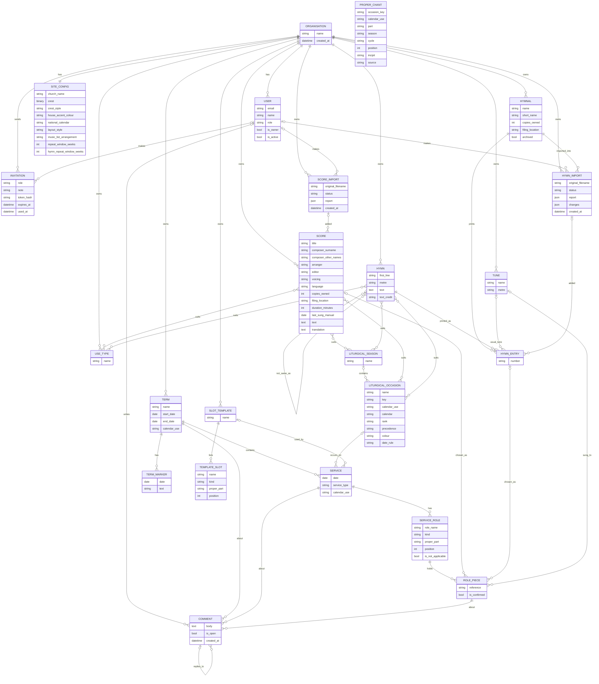

The same diagram is in [`docs/erd.mmd`](docs/erd.mmd).

### Fields

Every model also has an automatic `id` primary key.

**accounts.Organisation**

| Field        | Type          | Constraints | Purpose                                 |
| ------------ | ------------- | ----------- | --------------------------------------- |
| `name`       | CharField     | max 200     | The church, school or department's name |
| `created_at` | DateTimeField | set on save | When it registered                      |

**accounts.User** (replaces Django's user; signs in by email)

| Field          | Type         | Constraints                    | Purpose                                       |
| -------------- | ------------ | ------------------------------ | --------------------------------------------- |
| `email`        | EmailField   | unique, stored lowercase       | Sign-in name                                  |
| `name`         | CharField    | optional, max 150              | Shown in the app                              |
| `organisation` | ForeignKey   | optional, to Organisation      | Their church; empty only for a site superuser |
| `role`         | CharField    | Conductor, Librarian or Viewer | What they may do                              |
| `is_owner`     | BooleanField | default False                  | Manages members, invitations and reset links  |
| `is_active`    | BooleanField | default True                   | False once the owner removes them             |

It also has Django's own `password`, `last_login`, `is_staff`,
`is_superuser` and `date_joined`.

**accounts.Invitation**

| Field                | Type                      | Constraints                    | Purpose                                                    |
| -------------------- | ------------------------- | ------------------------------ | ---------------------------------------------------------- |
| `organisation`       | ForeignKey                | to Organisation                | The church being joined                                    |
| `role`               | CharField                 | Conductor, Librarian or Viewer | The role the person will have                              |
| `note`               | CharField                 | optional, max 100              | Who it's for, to tell invitations apart                    |
| `token_hash`         | CharField                 | unique, 64 characters          | SHA-256 of the link's secret; the secret itself isn't kept |
| `created_by`         | ForeignKey                | to User, set null on delete    | Who made it                                                |
| `created_at`         | DateTimeField             | set on save                    | When it was made                                           |
| `expires_at`         | DateTimeField             | required                       | Seven days after it was made                               |
| `used_at`, `used_by` | DateTimeField, ForeignKey | optional                       | When and by whom it was used; it works once                |

**library.Score**

| Field                                                       | Type                      | Constraints           | Purpose                              |
| ----------------------------------------------------------- | ------------------------- | --------------------- | ------------------------------------ |
| `organisation`                                              | ForeignKey                | to Organisation       | The church's library it's in         |
| `title`                                                     | CharField                 | max 200               | Title                                |
| `composer_surname`                                          | CharField                 | max 100               | Used for sorting                     |
| `composer_other_names`                                      | CharField                 | optional, max 100     | Forenames and any particle           |
| `arranger`, `editor`                                        | CharField                 | optional, max 200     | Arranger, and editor of this edition |
| `voicing`                                                   | CharField                 | optional, max 50      | As printed, e.g. SATB or SSATB       |
| `soprano_parts`, `alto_parts`, `tenor_parts`, `bass_parts`  | PositiveSmallIntegerField | default 0             | How many parts of each voice         |
| `language`                                                  | CharField                 | optional, max 50      | e.g. Latin, English                  |
| `copies_owned`                                              | PositiveIntegerField      | default 0             | How many copies the church has       |
| `filing_location`                                           | CharField                 | optional, max 100     | Where the copies are kept            |
| `duration_minutes`                                          | PositiveIntegerField      | optional              | Length                               |
| `background`, `notes`                                       | TextField                 | optional              | The piece's history; rehearsal notes |
| `text`, `translation`, `translation_credit`                 | TextField, CharField      | optional              | The words, for the pew sheet         |
| `range_soprano`, `range_alto`, `range_tenor`, `range_bass`  | CharField                 | optional, max 20      | Lowest to highest note               |
| `last_sung_manual`                                          | DateField                 | optional              | History from before Precentor        |
| `import_batch`                                              | ForeignKey                | optional, to ScoreImport | The import that added it          |
| `suited_use_types`                                          | ManyToMany                | to UseType            | Kinds of service it suits            |
| `suited_seasons`                                            | ManyToMany                | to LiturgicalSeason   | Seasons it suits                     |
| `suited_occasions`                                          | ManyToMany                | to LiturgicalOccasion | Particular days it suits             |

**library.ScoreImport** (a spreadsheet imported into the library)

| Field               | Type          | Constraints                 | Purpose                                         |
| ------------------- | ------------- | --------------------------- | ----------------------------------------------- |
| `organisation`      | ForeignKey    | to Organisation             | Whose library                                   |
| `created_by`        | ForeignKey    | to User, set null on delete | Who imported it                                 |
| `created_at`        | DateTimeField | set on save                 | When                                            |
| `original_filename` | CharField     | max 255                     | The file's name, or "a Google Sheet"            |
| `status`            | CharField     | pending or kept             | While pending, the whole import can be removed  |
| `report`            | JSONField     | optional                    | Rows skipped and why, and likely duplicates     |

**planning.Term**

| Field                    | Type       | Constraints                    | Purpose                            |
| ------------------------ | ---------- | ------------------------------ | ---------------------------------- |
| `organisation`           | ForeignKey | to Organisation                | Whose term                         |
| `name`                   | CharField  | max 100                        | e.g. Michaelmas 2026               |
| `start_date`, `end_date` | DateField  | required                       | The term's dates                   |
| `calendar_use`           | CharField  | Ordinary or Extraordinary Form | Which calendar its services follow |

**planning.Service**

| Field                  | Type       | Constraints                     | Purpose                          |
| ---------------------- | ---------- | ------------------------------- | -------------------------------- |
| `term`                 | ForeignKey | to Term                         | The term it's in                 |
| `organisation`         | ForeignKey | copied from the term            | Whose service                    |
| `date`                 | DateField  | required                        | When                             |
| `service_type`         | CharField  | max 50                          | e.g. Sung Mass, Vespers          |
| `occasion`             | ForeignKey | optional, to LiturgicalOccasion | The main day; sets the colour    |
| `additional_occasions` | ManyToMany | to LiturgicalOccasion           | Other days it also marks         |
| `calendar_use`         | CharField  | optional                        | Overrides the term's calendar    |
| `hymns`, `psalm`       | CharField  | optional                        | No longer shown; copied into slots, to be dropped |
| `slot_template`        | ForeignKey | optional, to SlotTemplate       | The template its slots came from |

**planning.TermMarker** (a "notice" in the app)

| Field          | Type       | Constraints          | Purpose                     |
| -------------- | ---------- | -------------------- | --------------------------- |
| `term`         | ForeignKey | to Term              | The term it's in            |
| `organisation` | ForeignKey | copied from the term | Whose notice                |
| `date`         | DateField  | required             | Where it falls in the term  |
| `text`         | CharField  | max 200              | e.g. Half term, no services |

**planning.ServiceRole** (a "slot" in the app)

| Field               | Type                 | Constraints             | Purpose                          |
| ------------------- | -------------------- | ----------------------- | -------------------------------- |
| `service`           | ForeignKey           | to Service              | The service it's in              |
| `organisation`      | ForeignKey           | copied from the service | Whose slot                       |
| `role_name`         | CharField            | max 50                  | e.g. Introit, Offertory motet    |
| `kind`              | CharField            | one of ten kinds        | How it's shown and grouped       |
| `proper_part`       | CharField            | optional                | Which proper it is, e.g. Introit |
| `is_not_applicable` | BooleanField         | default False           | Marked N/A, so it needs no piece |
| `position`          | PositiveIntegerField | default 0               | Order within the service         |

**planning.RolePiece** (a proposed piece)

| Field          | Type         | Constraints          | Purpose                    |
| -------------- | ------------ | -------------------- | -------------------------- |
| `service_role` | ForeignKey   | to ServiceRole       | The slot it's proposed for |
| `organisation` | ForeignKey   | copied from the slot | Whose piece                |
| `score`        | ForeignKey   | optional, to Score   | The music, from the library |
| `hymn_entry`   | ForeignKey   | optional, to HymnEntry | Or a hymn by book and number |
| `reference`    | CharField    | optional, max 200    | Or a typed reference, e.g. Psalm 150 |
| `tune`         | ForeignKey   | optional, to Tune, hymns only | A tune other than the book's own |
| `is_confirmed` | BooleanField | default False        | Proposed or confirmed      |

**library.Hymnal**, **Hymn**, **HymnEntry** and **Tune** (hymns, built up through use)

| Model and field                         | Type                 | Constraints                       | Purpose                                   |
| --------------------------------------- | -------------------- | --------------------------------- | ----------------------------------------- |
| Each model's `organisation`              | ForeignKey           | to Organisation; an entry takes its hymnal's | Whose hymns                    |
| Hymnal `name`, `short_name`             | CharField            | the code unique in the church     | e.g. New English Hymnal, NEH              |
| Hymnal `copies_owned`, `filing_location`, `archived` | as for scores | archived rather than deleted once used | A library entry like a score     |
| Hymn `first_line`, `metre`, `text`, `text_credit` | CharField, TextField | all optional, metre normalised | The text, whichever books print it    |
| Hymn `suited_*`                          | ManyToMany           | as for scores                     | What it suits, for suggestions            |
| Hymn `not_same_as`                       | ManyToMany to itself | symmetrical                       | "A different hymn", remembered            |
| HymnEntry `hymn`, `hymnal`, `number`     | ForeignKey, CharField | number unique in the hymnal      | Where a hymn is printed: NEH 53           |
| HymnEntry `tune`                         | ForeignKey           | optional, to Tune                 | The tune the book prints it with          |
| HymnEntry `import_batch`                 | ForeignKey           | optional, to HymnImport           | The import that added it, while pending   |
| Tune `name`, `metre`                     | CharField            | metre normalised                  | A tune by name, with its metre            |

**library.HymnImport** (a hymnal's list, imported): `organisation`,
`hymnal`, `created_by`, `created_at`, `original_filename` and `status`
(pending or kept) as for ScoreImport; `report` (JSONField) for the
result page, and `changes` (JSONField) recording each blank it filled
and each tune it added, so removing it can undo them.

**planning.SlotTemplate**

| Field          | Type       | Constraints                      | Purpose                     |
| -------------- | ---------- | -------------------------------- | --------------------------- |
| `organisation` | ForeignKey | to Organisation                  | Whose template              |
| `name`         | CharField  | max 50, unique within the church | e.g. Mass, Vespers          |
| `slot_names`   | TextField  | no longer read                   | The slots' first form; to be dropped |

**planning.TemplateSlot** (one slot of a template)

| Field          | Type                 | Constraints                  | Purpose                        |
| -------------- | -------------------- | ---------------------------- | ------------------------------ |
| `template`     | ForeignKey           | to SlotTemplate              | The template it's in           |
| `organisation` | ForeignKey           | copied from the template     | Whose slot                     |
| `name`         | CharField            | max 50, once per template (the form checks) | e.g. Introit, Entrance hymn    |
| `kind`, `proper_part` | CharField     | from the name when left blank | How it's shown, which proper  |
| `position`     | PositiveIntegerField | from the form's order        | Its place in the template      |

**ordo.LiturgicalOccasion** (shared by every church)

| Field                          | Type       | Constraints                    | Purpose                                |
| ------------------------------ | ---------- | ------------------------------ | -------------------------------------- |
| `name`, `key`                  | CharField  | key unique within its calendar | Display name and stable identifier     |
| `calendar_use`                 | CharField  | Ordinary or Extraordinary Form | Which form of the rite                 |
| `calendar`                     | CharField  | general, England or Wales      | General or national calendar           |
| `rank`, `precedence`, `colour` | CharField  | optional, fixed choices        | How it ranks, and its liturgical colour |
| `season`                       | ForeignKey | optional, to LiturgicalSeason  | The season it falls in                 |

Its date is worked out each year from `date_rule`, `date_rule_args`,
`date_offset_days`, `fixed_month`, `fixed_day`, `easter_offset_days`,
`is_moveable` and `transfers`; `is_proper_of_time` and
`shares_with_memorials` decide what happens when two days fall
together.

**ordo.LiturgicalSeason** (shared): `name` (CharField, max 50).

**ordo.ProperChant** (shared by every church; loaded by `load_calendar`)

| Field          | Type      | Constraints                                | Purpose                                     |
| -------------- | --------- | ------------------------------------------ | ------------------------------------------- |
| `occasion_key` | CharField | max 100                                    | The occasion's key, e.g. `tempora:Adv2-0`   |
| `calendar_use` | CharField | choices                                    | Which form of the Mass                      |
| `part`         | CharField | choices: Introit to Communion, Antiphon, Responsory, Hymn, Canticle | Which chant              |
| `season`       | CharField | blank, Septuagesima to Easter, or Eastertide | A saint's day's form for that season      |
| `cycle`        | CharField | blank, A, B or C                           | An Ordinary Form Sunday's chant for one year |
| `position`     | PositiveSmallIntegerField | default 0                  | Its place among the day's chants of a part  |
| `incipit`      | CharField | max 100                                    | The opening words, e.g. Populus Sion        |
| `source`       | CharField | max 100                                    | The file it came from                       |

One chant per part, season, year, position and day in each form; most
days have one of each part, at position 0, and a day with several, such
as Palm Sunday's antiphons, numbers them in the order sung. It's matched to an
occasion by key, not a foreign key: occasions are rebuilt from their
files, and a national calendar repeats a key to move a day whose Mass
is the same.

**ordo.UseType**: `organisation` (ForeignKey) and `name` (CharField,
max 50), such as Mass, Vespers or General. Each church has its own.

**comments.Comment**

| Field                       | Type                             | Constraints            | Purpose                               |
| --------------------------- | -------------------------------- | ---------------------- | ------------------------------------- |
| `author`                    | ForeignKey                       | optional, to User      | Who wrote it; empty once they delete their account, shown as "A former member" |
| `organisation`              | ForeignKey                       | copied from its target | Whose comment                         |
| `content_type`, `object_id` | ForeignKey, PositiveIntegerField | generic relation       | The term, service or piece it's about |
| `parent`                    | ForeignKey                       | optional, to Comment   | The comment it replies to             |
| `body`                      | TextField                        | required               | The text                              |
| `is_open`                   | BooleanField                     | default True           | Closed once resolved                  |
| `created_at`                | DateTimeField                    | set on save            | When                                  |

**core.SiteConfig** (each church's settings)

| Field                                  | Type                   | Constraints                        | Purpose                                 |
| -------------------------------------- | ---------------------- | ---------------------------------- | --------------------------------------- |
| `organisation`                         | OneToOneField          | to Organisation                    | One settings row per church             |
| `church_name`                          | CharField              | optional, max 200                  | Heading of the music list               |
| `crest`, `crest_type`, `crest_version` | BinaryField, CharField | optional                           | The crest image, kept in the database   |
| `crest_style`                          | CharField              | logo or banner                     | How the crest is shown                  |
| `house_accent_colour`                  | CharField              | hex colour, checked by a validator | Colour for services without an occasion |
| `national_calendar`                    | CharField              | general, England or Wales          | Which national days are added           |
| `layout_style`                         | CharField              | columns or simple                  | Music list layout                       |
| `music_list_arrangement`               | CharField              | service order or propers beside    | How each service's music is arranged    |
| `repeat_window_weeks`                  | PositiveSmallIntegerField | 1 to 104, default 8             | How recent counts as "sung recently"    |
| `hymn_repeat_window_weeks`             | PositiveSmallIntegerField | 1 to 104, default 6             | The same, for hymns                     |
| `show_hymns_psalm`                     | BooleanField           | default True                       | No longer used; to be dropped           |

### Rules the database enforces

- A user has an organisation and a role together, or neither (a
  superuser has neither).
- An owner belongs to an organisation, and is a Conductor or a
  Librarian, never a Viewer.
- An organisation has at most one owner.
- Email addresses are unique whatever their capitals.
- Slot template names are unique within each church.
- A piece is exactly one of a score, a hymn entry or a typed reference,
  and only a hymn can have a tune.
- A hymnal's code is unique within each church, and a number appears
  once in a hymnal. A hymnal with hymns recorded from it can't be
  deleted.
- A score or a hymn entry chosen for a service can't be deleted while
  the piece remains.
- An occasion's key is unique within its calendar.
- A day has one chant for each part, season, year and position in each
  form.
- An invitation's stored fingerprint is unique.

[↑ Back to contents](#contents)

## 14. Phones, dark mode and the keyboard

Every page works from 320 pixels wide upwards, and none makes the page
scroll sideways. Rows of buttons wrap under what they belong to, the
library's filters stack above its table, and the table scrolls inside
its own box rather than widening the page. I checked 25 pages at five
widths in three browser engines, and on my own iPhone and iPad
([the testing record, section 6](docs/testing.md#6-responsiveness-usability-and-the-keyboard)).

<a id="figure-28"></a>

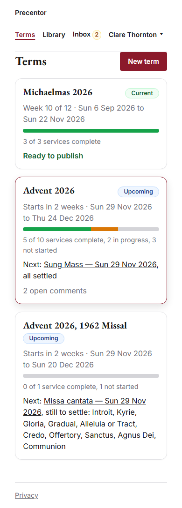

_Figure 28. The Terms page on a phone._

<a id="figure-29"></a>

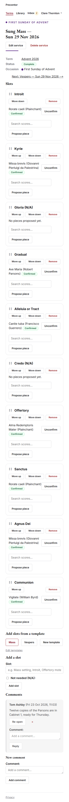

_Figure 29. A service on a phone._

<a id="figure-30"></a>

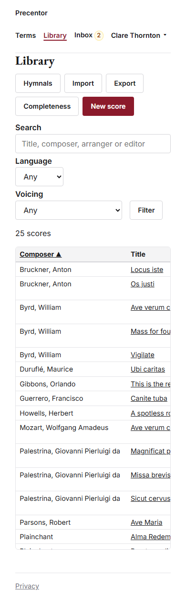

_Figure 30. The library on a phone; the table scrolls within its own box rather than widening the page._

Dark mode follows the device's own setting, and Appearance in the user
menu can choose System, Light or Dark, remembered on that device. The
colours are design tokens, each given a dark value where it needs one,
so the whole app changes together, and every piece of text keeps WCAG
AA contrast in both ([row R05](docs/testing.md#r05)).

<a id="figure-31"></a>

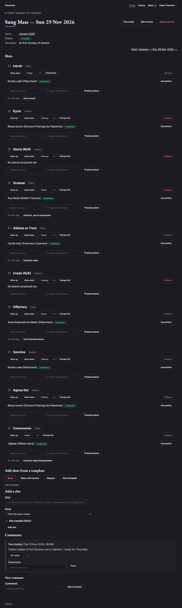

_Figure 31. A service in dark mode, which follows the device's setting or the choice in the user menu._

Everything can be done from the keyboard. Links, buttons and fields
show an outline when reached with Tab, a skip link jumps past the
navigation, the score search box works with the arrow keys, and slots
move with Move up and Move down as well as by dragging
([row R04](docs/testing.md#r04)).

<a id="figure-32"></a>

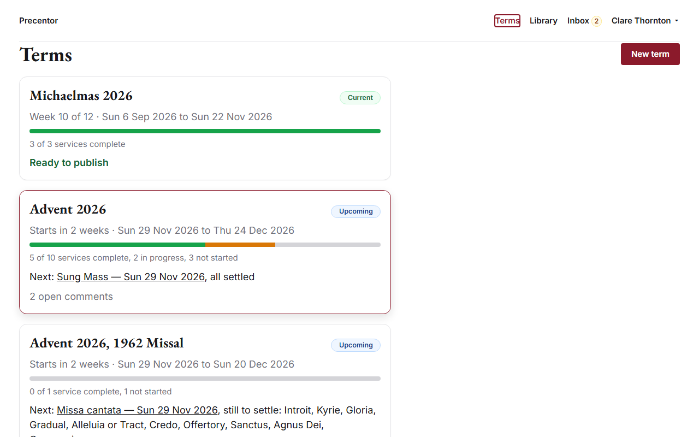

_Figure 32. Keyboard focus: links and buttons show an outline when reached with Tab._

[↑ Back to contents](#contents)

## 15. Features and CRUD

Each cell names the page, or the URL name in that app's `urls.py`, that
does it. Every page is limited to the signed-in person's own church, and
the role column in [§2](#2-who-this-is-for) says who may use each one.

| Model                       | Create                                                    | Read                                               | Update                                                                                          | Delete                                                        | Locate                                                                     |
| --------------------------- | --------------------------------------------------------- | -------------------------------------------------- | ----------------------------------------------------------------------------------------------- | ------------------------------------------------------------- | -------------------------------------------------------------------------- |
| Organisation                | Sign-up page (`signup`)                                   | Its name on every page and the music list          | Church name on Settings (`site_config_update`)                                                  | The owner, after typing its name (`delete_church`)           | not needed: everyone sees only their own                                   |
| User                        | Joining by invitation (`join`); sign-up for the owner     | Members page (`member_list`)                       | Role (`change_role`), owner (`make_owner`), own password (`password_change`) or by a reset link the owner makes (`reset_link`), opened at `password_reset_confirm` | Removed, not deleted (`remove`), and brought back (`restore`); their own account, after their password (`delete_account`) | Members page                                                               |
| Invitation                  | Invite someone (`invite`)                                 | Link shown once (`invitation_link`); Members page  | not available (cancel and make another)                                                         | Cancel (`invitation_cancel`)                                  | Members page, "Waiting to join"                                            |
| Score                       | Add score (`score_create`), also from a piece not in the library, or many at once by importing | Library (`score_list`), score page (`score_detail`), or all as a CSV (`export_library`) | Edit (`score_update`)                                                                          | Delete, after a confirmation (`score_delete`)                 | Search box; Language, Voicing, Season, Use and Occasion filters; sortable columns; the completeness page (`completeness`) |
| Import (`ScoreImport`)      | Import a spreadsheet or a Google Sheets link (`score_import`), from the template (`import_template`) | Result page (`score_import_detail`), Imports list (`score_import_list`) | Keep it (`keep_import`)                                                                          | Remove it and its scores, after a confirmation (`remove_import`) | Imports list, waiting ones first; a notice on the Library while one waits |
| Hymnal                      | New hymnal (`hymnal_create`)                              | Hymnals (`hymnal_list`), its page (`hymnal_detail`) | Edit, archive (`hymnal_update`) | Delete, after a confirmation, unless hymns were sung from it (`hymnal_delete`) | Hymnals page, linked from the Library |
| A hymnal's import (`HymnImport`) | Import a list or a Google Sheets link from the hymnal's page (`hymn_import`), from the template (`hymn_import_template`) | Result page (`hymn_import_detail`) | Keep it (`keep_hymn_import`) | Remove it after a confirmation, taking away the entries and tunes it added and emptying the blanks it filled, unless they're in use (`remove_hymn_import`) | The hymnal's page, with a notice while one waits |
| Hymn and its entries        | Made by typing a book and number into a Hymn slot           | Its page (`hymn_detail`), its hymnal's page          | Edit details (`hymn_update`), its tune in a book (`hymn_entry_update`), join with the same hymn (`same_hymn`) | not available: a hymn is part of the history | Each hymnal's page, in number order; the completeness page |
| Tune                        | New tune (`tune_create`)                                  | Tunes (`tune_list`)                                  | Edit (`tune_update`) | not available | Tunes page, linked from Hymnals |
| Term                        | New term (`term_create`)                                  | Terms page (`term_list`), term page (`term_detail`), music list (`term_music_list`) | Edit (`term_update`)                                                                           | Delete, after a confirmation (`term_delete`)                  | Terms page, current and upcoming first, past folded away                   |
| Service                     | New service (`service_create`), occasion suggested from the date | Service page (`service_detail`), term page, pew sheet (`service_pew_sheet`) | Edit (`service_update`)                                                                         | Delete, after a confirmation (`service_delete`)               | Term page in date order; previous and next links on each service           |
| Notice (`TermMarker`)       | New notice (`marker_create`)                              | Term page and music list                           | Edit (`marker_update`)                                                                          | Delete (`marker_delete`)                                      | Term page                                                                  |
| Slot (`ServiceRole`)        | Add a slot (`add_role`) or from a template (`apply_template`) | Service page                                   | Move (`move_slot`), drag to reorder (`reorder_slots`), change kind (`change_kind`), mark N/A when adding | Remove (`remove_slot`), asking first if it has pieces         | Service page                                                               |
| Piece (`RolePiece`)         | Propose a score, a hymn by book and number, or a reference, or propose and confirm at once (`add_piece`) | Service page, score page history, music list       | Confirm and unconfirm (`toggle_confirm`); a hymn's tune (`set_tune`)                                                        | Remove (`remove_piece`), asking first if it's confirmed or has comments | Service page; the score page lists where each score was used               |
| Slot template               | New template (`slot_template_create`)                     | Templates page (`slot_template_list`)              | Edit (`slot_template_update`)                                                                   | Delete (`slot_template_delete`)                               | Templates page; buttons on each service                                    |
| Template slot (`TemplateSlot`) | A blank row on the template form (`slot_template_create`, `slot_template_update`) | Templates page, listed under each template; the template form | Name, kind, proper part and order on the template form | The row's Remove box on the template form | The template form, in order |
| Use type                    | Typed on the score form                                   | Score page; the Library's Use filter               | not available                                                                                   | not available                                                 | Library filter                                                             |
| Comment                     | Comment or reply (`add_comment`)                          | Inbox (`inbox`); each term's and service's thread  | Close and reopen (`toggle_close`); the text can't be edited                                     | Delete a closed thread (`delete_comment`)                     | Inbox of open threads; the count in the menu                               |
| Settings (`SiteConfig`)     | Made with the church                                      | Settings page; the music list                      | Settings (`site_config_update`)                                                                 | not available                                                 | not needed: one per church                                                 |
| Liturgical occasion, season | Loaded by `manage.py load_calendar`                       | Service pages, occasion menus, the music list      | not available (shared reference data)                                                           | not available                                                 | The service form suggests the day's occasions from its date                |
| The day's chants (`ProperChant`) | Loaded by `manage.py load_calendar` | Offered on a Proper, Antiphon, Responsory, Hymn or Canticle slot's add-piece form and its propose page (`add_piece`) | not available (shared reference data) | not available | Chosen from the service's occasion and date |

### Validation and feedback

- **Form errors** appear beside the field they belong to, and Django
  marks that field `aria-invalid`, which screen readers announce and the
  styles outline in red. Forms check what the database would refuse, such
  as a template name already used in the church or an address already
  registered, so the message is plain rather than a server error.
  They also refuse dates that make no sense (a term ending before it
  starts, a service outside its term, or new term dates that would
  leave services outside it) and the same piece twice in one slot.
- **A button can't be pressed twice.** While a form's request is on
  its way, its button is disabled and marked busy, so a double-click
  sends it once. Confirm asks for a state rather than switching, so
  even two requests leave a piece as asked.
- **Success and warning messages** appear after an action, such as
  "Ben Jonson is now a Librarian." or "That invitation has already been
  used or cancelled.", shown at the top of the next page.
- **Deleting asks first.** Scores, terms, services, notices, templates,
  invitations, members and imports each have a confirmation page. Removing a slot
  that has pieces asks in a dialog with JavaScript, or on a page
  without. Going Back to a confirmation page for something already deleted leads
  to its list with a message, not an error.
- **Permissions** give a "Not available to you" page (403) that says
  why, and another church's records give "Page not found" (404).

[↑ Back to contents](#contents)

## 16. Design decisions that depart from convention

Some choices go against what a reader might expect, or against what the
usual checklists ask for. Each one is deliberate, and this is why.

- **An unknown address shows a page, not a redirect.** The common
  advice is to send a mistyped address to the home page. Precentor
  answers with a "Page not found" page, a real 404 status and a Go to
  Terms button instead. A silent redirect hides the mistake: the person
  doesn't learn the link was wrong, and a browser or another site is
  told a missing page exists. The button still gets them home in one
  click.
- **Another church's record is "not found", not "forbidden".** Opening a
  record from another church by its address gives the same 404 page as
  an address that never existed. A 403 would confirm the record is
  there.
- **A refused action shows a page, not the sign-in screen.** Django's
  `user_passes_test` and `permission_required` decorators send someone
  who fails the check to log in, even when they're signed in already,
  which would loop. The "Not available to you" page (403) says their
  role doesn't include this, that they can still see everything and
  comment, and to ask a conductor.
- **Slots are reordered with buttons as well as by dragging.** Dragging
  can't be done from a keyboard or by many assistive technologies, so
  each slot has Move up and Move down buttons, which also work without
  JavaScript. Dragging is an extra for a mouse or a finger, and sends
  the new order to the server when it's dropped.
- **Removing someone switches their account off.** The usual delete
  would take their comments' authorship with it. A removed member can't
  sign in, but their name stays on what they wrote, and the owner can
  bring them back from the Members page.
- **There's no email.** Invitations and reset links are made by the
  owner and passed on by hand, and nobody can reset their own password.
  Precentor has no mail provider, so the usual "Forgot your password?"
  link would promise something it can't do; I took it out rather than
  leave it broken ([§20](#20-future-work)).
- **Deleting is refused where history would be lost.** A score that
  has been planned for a service can't be deleted, a hymn can't be
  deleted at all, and a hymnal that has been used is archived instead.
  The score's page says why. What a choir sang is the record the
  library exists to keep.
- **Viewers see drafts.** A read-only role often sees only what's
  finished. Here a Viewer is a read-only member who can comment, and
  commenting on a draft needs sight of it, so Viewers see the draft
  music list, the pew sheet and every proposed piece, while changing
  nothing. Signed-out visitors see none of it, and another church's
  members get "not found".
- **Comments can't be edited, and only closed threads can be deleted.**
  Most comment systems allow both. Here a thread is a short working
  record between a conductor and a librarian, so what was said stays as
  it was said, and nothing can be removed from a discussion still under
  way ([§6](#6-comment-threads)).
- **Printing sits outside the cascade layers.** Every other rule lives in
  a layer, but the print rules for the music list and pew sheet are
  left unlayered and use points rather than the fluid scale. Unlayered
  rules beat every layered one, so a printed list can never show the
  buttons, and points are the unit paper is measured in.
- **Some lists carry `role="list"` though the validator calls it
  unnecessary.** Safari stops announcing a list as a list once its
  bullets are removed with `list-style: none`. The attribute puts that
  back, so the W3C checker's warnings of this kind are expected (see
  [`docs/testing.md`](docs/testing.md)).
- **The sign-in pages load a second stylesheet.** Every other page links
  only `precentor.css`. Log in, Register and Join also link
  `no-page-transition.css`, which turns off the page transitions the
  rest of the site uses. `@view-transition` can't be limited to some
  pages, so it can't live in the shared file, and without it Chromium
  held the page after signing in frozen for several seconds.

[↑ Back to contents](#contents)

## 17. Security

- **Secrets stay out of the repository.** `SECRET_KEY`, the database
  address and the allowed hosts are read from environment variables. A
  local `.env` file supplies them in development, and `.env` is ignored
  by git. If `SECRET_KEY` is missing the site refuses to start, with a
  message saying so, rather than running with a default.
- **`DEBUG` is off unless it's switched on.** It's only on when the
  environment says `DEBUG=True`, so a deploy that forgets it is safe.
- **HTTPS once deployed.** With `DEBUG` off, plain `http://` requests are
  redirected to `https://`, the session and CSRF cookies are only sent
  over HTTPS, and browsers are told through HSTS to use HTTPS for this
  site. `python manage.py check --deploy` reports no issues.
- **Forms are protected against cross-site requests** by Django's CSRF
  middleware: every form that changes something posts a CSRF token,
  including the ones JavaScript sends.
- **One permissions module.** Every check of who may do what lives in
  `accounts/permissions.py`, used by views, by a decorator and mixin,
  and by templates through `can`, so a button and the page behind it
  always agree. A test holds the whole roles table from [§2](#2-who-this-is-for) against those
  checks.
- **Each church only reaches its own data.** Every query on a church's
  data is limited to the signed-in person's organisation, which comes
  from their account, never from the address or a form. Opening another
  church's record by its address gives a 404, not a 403, so its
  existence isn't confirmed. Forms only offer, and only accept, the
  church's own scores, hymnals, tunes, use types and templates.
- **Passwords** are stored with Django's password hashers and checked
  against its validators: at least eight characters, not all numbers,
  not a common password and not too like the person's name or email.
- **Invitations work once and expire after a week.** Only a SHA-256
  fingerprint of each link's secret is stored, so the database can't be
  used to make working links. Reset links are Django's own signed
  tokens, which stop working once used, once the person signs in, or
  after three days.
- **Removing someone** switches their account off, which signs them out
  on their next request.
- **Limits on trying.** Five wrong passwords lock that address for 15
  minutes, before any further password is even checked, and one network
  can register at most five churches an hour. The counts are kept under
  a fingerprint, never the email address itself.
- **Signed-in pages aren't stored.** Every response to someone signed in
  says `private, no-store`, so a browser or proxy keeps no copy for the
  next person at a shared computer. The session cookie can't be read by
  page scripts, and neither cookie is sent with a form posted from
  another site.
- **Imported files are checked, not trusted.** A file over 2 MB or 5,000
  rows is refused, every row goes through the same form as a score added
  by hand, and the import is saved in one transaction, so a failure
  leaves nothing behind. In an export, a cell that starts with `=`, `+`,
  `-` or `@` gets an apostrophe in front, so a spreadsheet opens it as
  text instead of running it as a formula.
- **A pasted Google Sheets link can't send the server elsewhere.** The
  server never fetches the address that was typed. It takes the
  sheet's ID out of the link with a strict pattern and builds Google's
  own CSV export address from it, waits at most ten seconds, and reads
  no more than the import's 2 MB limit. Anything Google sends that
  isn't CSV, such as its sign-in page for a sheet that isn't shared, is
  refused with a message saying how to share it.
- **Going back is only ever to this site.** A form that returns to the
  page it was opened from, such as editing a score from a service, only
  follows that address if it's a page on this site, so a crafted link
  can't send someone elsewhere after they save.

[↑ Back to contents](#contents)

## 18. Running it locally

These steps are for Windows with PowerShell; on macOS or Linux, activate
the virtual environment with `source venv/bin/activate` instead. You
need Python 3.14 and git.

1. Clone the repository and go into it:

   ```powershell
   git clone https://github.com/StockoL/precentor.git
   cd precentor
   ```

2. Create and activate a virtual environment, then install the
   requirements:

   ```powershell
   python -m venv venv
   venv\Scripts\Activate.ps1
   pip install -r requirements.txt
   ```

3. Create a file called `.env` in the repository's root folder with a
   secret key of your own and `DEBUG` switched on:

   ```text
   SECRET_KEY=any-long-random-string
   DEBUG=True
   ```

4. Set up the database, which is a local SQLite file unless
   `DATABASE_URL` says otherwise, with its cache table, and load the
   liturgical calendar:

   ```powershell
   python manage.py migrate
   python manage.py createcachetable
   python manage.py load_calendar
   ```

5. Optionally make a superuser for the admin pages, then start the site:

   ```powershell
   python manage.py createsuperuser
   python manage.py runserver
   ```

   Open <http://127.0.0.1:8000/>, choose **Register** and register a
   church to start using it.

6. Run the tests:

   ```powershell
   python manage.py test
   ```

   The browser tests use Playwright, which isn't in `requirements.txt`
   because the site doesn't need it to run. Install it, with flake8,
   once with `pip install -r requirements-dev.txt`, then
   `playwright install chromium`.

### Making the screenshots

Every image comes from an invented church, St Aelred's, Ripon, with
invented people, so no real church or person appears. I made them with
two scripts in `tools/`, against a separate SQLite file rather than my
development database:

1. `settings.py` reads the database from `DATABASE_URL`, so I set it for
   one PowerShell session:
   `$env:DATABASE_URL = "sqlite:///screenshots.sqlite3"`. Everything run
   in that session uses `screenshots.sqlite3`, which git ignores.
2. `python tools/seed_demo.py` migrates that file, loads the liturgical
   calendar into it and builds the church through the app's own
   `create_organisation()` and models: three people, 25 scores, a hymn
   book of its own with made-up numbers, a past term, an Advent term
   with services in every state, a 1962 Mass, notices, comments and a
   crest drawn in code.
3. `python manage.py runserver 8766` serves it.
4. `python tools/take_screenshots.py`, in a second terminal with the same
   `DATABASE_URL`, drives Chromium through Playwright (already used for
   the browser tests). It registers a new church for [Figures 1 to 3](#figure-1),
   signs in as the demo Conductor and Viewer for the rest, and saves
   each page at 1280 by 800 or, for the phone figures, 390 by 844. For
   Figures [8](#figure-8) and [9](#figure-9) it imports a small file, then removes the import
   through its own page, so the demo church is left as it was.
   Images over 300 KB are reduced to 256 colours.
5. My local `.env` turns `DEBUG` on, which shows Django's debug page in
   place of the 404 page, so for [Figure 26](#figure-26) the script renders the page
   with `DEBUG` off through Django's test client and photographs that.

[↑ Back to contents](#contents)

## 19. Environment variables

Everything below is read in `precentor_project/settings.py`.

| Variable                   | What it does                                                                                     | Default                               |
| -------------------------- | ------------------------------------------------------------------------------------------------ | ------------------------------------- |
| `SECRET_KEY`               | Django's signing key, for sessions, CSRF and reset links                                         | none: the site won't start without it |
| `DEBUG`                    | `True` turns on Django's debug pages and turns off the HTTPS settings; anything else leaves it off | off                                 |
| `DATABASE_URL`             | Which database to use, as a URL, read by `dj-database-url`                                       | `sqlite:///db.sqlite3`                |
| `ALLOWED_HOSTS`            | Comma-separated host names the site answers to                                                   | none; with `DEBUG` on, Django allows localhost |
| `CSRF_TRUSTED_ORIGINS`     | Comma-separated origins allowed to post forms, such as `https://example.com`                     | none                                  |
| `RENDER_EXTERNAL_HOSTNAME` | Set by Render; added to the allowed hosts and trusted origins                                    | none                                  |
| `SECURE_HSTS_SECONDS`      | How long browsers are told to use only HTTPS, when `DEBUG` is off                                | 3600 (one hour)                       |

[↑ Back to contents](#contents)

## 20. Future work

What's designed or wanted but not built yet:

- **Dropping the four old columns.** Before slots had kinds, a
  service's hymns and psalm and a template's slots were kept as text.
  The merge copied them into slots and rows, and the copy was checked
  on the live data. A migration removing the old columns, with the
  little code that still reads them, is ready on the
  `drop-old-columns` branch and goes out as a deploy of its own
  ([`docs/merge_record.md`](docs/merge_record.md), step 6).
- **A rebuilt music list,** with a choice of paper sizes and columns.
- **Email.** Invitations and reset links are passed on by hand because
  Precentor sends no email. With a mail provider they could be sent
  directly, and people could reset their own passwords.
- **More propers.** The Ordinary Form's chants for weekdays and saints'
  days, and the nine England and Wales 1962 feasts, from the Commons
  the Latin Mass Society's Ordo gives them.
- **A Google Drive picker** on the import pages, to choose a file
  from Drive after signing in to Google. It needs a Google Cloud
  project, keys and a consent screen, and the Sheets link already
  covers most of what it would do, so I left it out.
- **A public link to a term's music list.** The list needs a login, so
  a church prints it or passes on a copy. A link anyone could open
  would let it go on a church's website.
- **Backup and restore.** A church can export its library, but not
  everything it holds as one file to keep or bring back.
- **One text for many settings.** A score's text and translation belong
  to that score, so the Ave verum is typed again for each composer who
  set it. A shared text would be entered once.

[↑ Back to contents](#contents)

## 21. Technologies used

**Languages:** HTML, CSS, JavaScript (hand-written ES modules, no
framework) and Python.

**Framework and libraries** (pinned in `requirements.txt`):

- [Django](https://www.djangoproject.com/) 6, on Python 3.14
- [dj-database-url](https://github.com/jazzband/dj-database-url), to
  read the database from `DATABASE_URL`
- [psycopg2](https://www.psycopg.org/) for PostgreSQL in production;
  SQLite locally
- [python-dotenv](https://github.com/theskumar/python-dotenv), to read
  `.env` in development
- [WhiteNoise](https://whitenoise.readthedocs.io/), to serve the static
  files
- [Gunicorn](https://gunicorn.org/), the web server on the host
- [Pillow](https://python-pillow.org/), to check and resize uploaded
  crests

**Hosting:** [Render](https://render.com), a web service and a
PostgreSQL database described by `render.yaml`.

**Building and testing:**

- [Playwright](https://playwright.dev/python/) with Chromium, for the
  browser tests and the README screenshots
- [Node.js](https://nodejs.org/), to run `build-tokens.js`, which turns
  the design tokens in `precentor-tokens.JSON` into CSS variables,
  `build-font-fallback.js`, and `build-css.js`, which joins the CSS
  files into the one stylesheet every page links
- [Utopia](https://utopia.fyi/), for the fluid type and spacing scales
- [flake8](https://flake8.pycqa.org/), [ESLint](https://eslint.org/),
  the [W3C HTML](https://validator.w3.org/nu/) and
  [CSS](https://jigsaw.w3.org/css-validator/) validators and
  [Lighthouse](https://developer.chrome.com/docs/lighthouse/), for the
  checks in [`docs/testing.md`](docs/testing.md)
- Git and GitHub, for version control

**Images:** [Inkscape](https://inkscape.org/) and
[GIMP](https://www.gimp.org/) 3.2.2, for creating and editing SVG
images.

**Use of AI.** I used an AI coding assistant as a pair programmer and
a sounding board: to talk through options, draft code and tests to my
specification, look for bugs, and check documents against the code.
The architecture, the data model, the design and every decision about
what Precentor does and how are my own, and I reviewed and approved
each change before it was committed.

[↑ Back to contents](#contents)

## 22. Testing

[`docs/testing.md`](docs/testing.md) has the full record. The manual
tests were run on 10 November 2026, and every check again the same day
at `8908668`, each with the checker's own screenshots. In short:

- **[954 automated tests](docs/testing.md#4-automated-tests)** cover the models, views, forms, permissions,
  each church's own data, the import and export, and the liturgical
  calendar and its chants. 68 of them are browser tests, which start a
  real server and drive Chromium through Playwright, so the JavaScript
  is tested too.
- **[Manual tests](docs/testing.md#5-manual-tests):** 65 rows covering every
  feature, grouped by feature, each carried out in Google Chrome with
  its result and screenshots beside them. Six failed and were fixed,
  each with its commit.
- **[Widths and browsers](docs/testing.md#6-responsiveness-usability-and-the-keyboard):** 25 pages at 320, 375, 768, 1024 and 1280
  pixels in Chromium, Firefox and WebKit, with nothing wider than the
  window and no console errors; the keyboard alone; dark mode, with
  every piece of text meeting WCAG AA contrast; and without JavaScript.
- **[Real devices](docs/testing.md#real-devices):** my iPhone, iPad and PC, on
  the live site.
- **[Validation](docs/testing.md#2-html-and-css-validation):** every page's HTML,
  75 in all, with no errors, and the 25 main pages again on the W3C's
  online checker; the CSS, where the only errors are newer CSS the
  validator doesn't know yet; ESLint and flake8 with no findings.
- **[Lighthouse](docs/testing.md#3-lighthouse-scores):** accessibility, best
  practices and SEO 100 on every page checked, on desktop and mobile;
  performance 100 on desktop and 94 to 99 on a simulated phone.
- **[Bugs found and fixed](docs/testing.md#7-bugs-found-and-fixed),** each with
  its commit, and the three known issues, none in the app itself.

---

_The overhaul is recorded phase by phase in
[`docs/overhaul_plan.md`](docs/overhaul_plan.md). What remains is
under Future work._

[↑ Back to contents](#contents)
