# Precentor

_A repertoire and service-planning tool for church musicians._

_Milestone 3 project, Code Institute_

**Live site:** [precentor.onrender.com](https://precentor.onrender.com)

The site runs on Render's free plan, so the first visit after a quiet
spell can take about a minute while it wakes up. Anyone can try it by
registering a church of their own on the sign-up page, so no login
details are needed.

> **Status:** Precentor is built and deployed. Churches register
> themselves and each works only in its own data. Inside a church there
> are accounts with email sign-in, three roles and an owner, who invites
> people by link, changes their roles, removes them and makes reset
> links (§5). The library of scores, term and service planning with
> slots and pieces, the Ordo liturgical calendar for both forms of the
> Roman Rite, comment threads, per-church settings with a crest, and the
> printable music list are all in place. Before the accounts work I
> overhauled the whole app, phase by phase, as recorded in
> [`docs/overhaul_plan.md`](docs/overhaul_plan.md). The CSV import is
> designed but not built (see [Future work](#19-future-work)).
>
> The rest of this document keeps its original concept-and-reasoning
> framing, because that reasoning is what the build followed. Where the
> build departed from an early plan (`LiturgicalOccasion`'s `fixed_date`
> becoming `fixed_month`/`fixed_day`, for example),
> [`docs/models_plan.md`](docs/models_plan.md) says so instead of
> editing the history away.

A **precentor** is the traditional title for the person who directs a
church's music, and that's the role this tool is built around. Its
liturgical calendar engine is named **Ordo**, after the book that sets
out a church's calendar of observances for the year; in this project
the name covers the feature that tracks liturgical seasons and feast
days.

---

## 1. The Problem

Choral conductors working in a church (Precentor is built for Catholic
choirs, though the pattern holds across traditions) plan music across a
term of several services a week, typically a midweek service and one or
two on Sunday. That involves:

- Knowing what music is available, and whether the choir can sing it
  now (the right voicing, the right forces).
- Avoiding over-repetition, while still allowing repeats on purpose.
- Matching music to the liturgical calendar. Some pieces are general;
  others are written for, or associated with, a particular season or
  feast day.
- Producing a clean, public "music list" for the congregation, which is
  currently a manual typing and formatting job every term.
- Coordinating with a librarian or music administrator who looks after
  the physical copies, separately from the conductor's musical
  decisions.

A spreadsheet serves this badly. It can't easily record relationships
(which piece was sung when, in what slot, for which service), and it
can't tell "still deciding" apart from "nothing planned here, on
purpose".

## 2. Who This Is For

Precentor is for church choirs and music departments, and one
installation serves many of them. Each church registers as its own
organisation and only ever sees its own scores, terms and people (§5).
A school or music department can register the same way. (A benefice
with several choirs under one director is an interesting edge case,
but one account belongs to one organisation, so it's out of scope.)

There are three user roles, reflecting how the work is actually divided:

| Role                        | Can change                                                                                           | Can see    |
| --------------------------- | ---------------------------------------------------------------------------------------------------- | ---------- |
| **Conductor**               | Planning (terms, services, slots, proposing, confirming, N/A), slot templates, the library, Settings | Everything |
| **Librarian / Music Admin** | The library: scores, copies owned, filing location                                                   | Everything |
| **Viewer**                  | Nothing, apart from taking part in comments                                                          | Everything |

Everyone takes part in the comment threads (see §6). A site superuser
has no role inside the app; they look after the site from Django's
admin pages.

### A church's first visit

A conductor finds Precentor, registers their church and is signed straight in. With nothing planned yet, the Terms page shows the first steps their role allows.

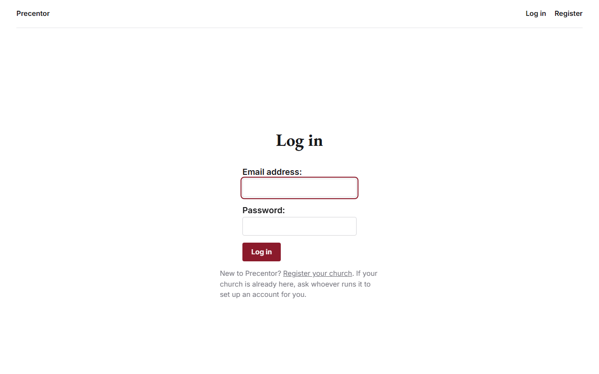

_Figure 1. Signing in by email. New visitors follow the link to register their church._

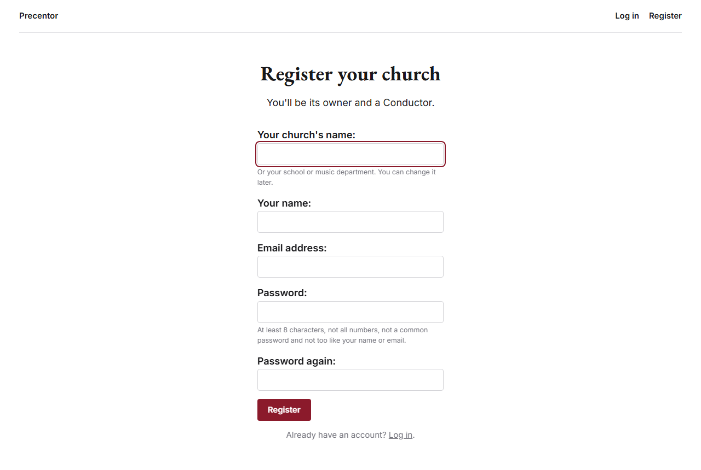

_Figure 2. Registering a church: the person who registers becomes its owner and a Conductor._

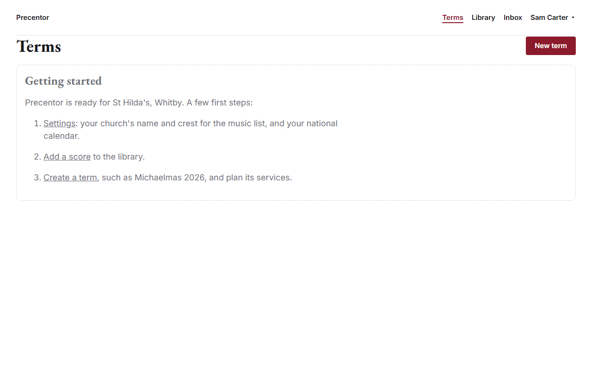

_Figure 3. A new church's first steps, shown until it has a term or a score._

## 3. Core Domain Concepts

The interface uses the words a choir uses, and two of them differ from
the model names in the code:

| In the interface | In the code   | What it is                                      |
| ---------------- | ------------- | ----------------------------------------------- |
| Slot             | `ServiceRole` | A place in a service for music, e.g. Introit    |
| Notice           | `TermMarker`  | A dated line on the music list, e.g. Half term  |

I kept the model names, because renaming them would rename database
tables without changing anything for the people using the app. Each
field's label is set once on the model with `verbose_name`, so the
forms and the admin both show the interface word.

### 3.1 Score

A piece of music in the library. Its fields cover the title, the
composer (surname and other names), any arranger and editor, the
voicing as printed (SATB, SSATB, unison and so on) with a count of each
voice part, the **language**, the number of copies owned and where
they're filed, the duration, background and interpretation notes, and
a vocal range for each part. Scores can be tagged with the uses,
seasons and occasions they suit.

**In the app.** The librarian adds scores, finds them again with search and filters, and keeps each one's details up to date.

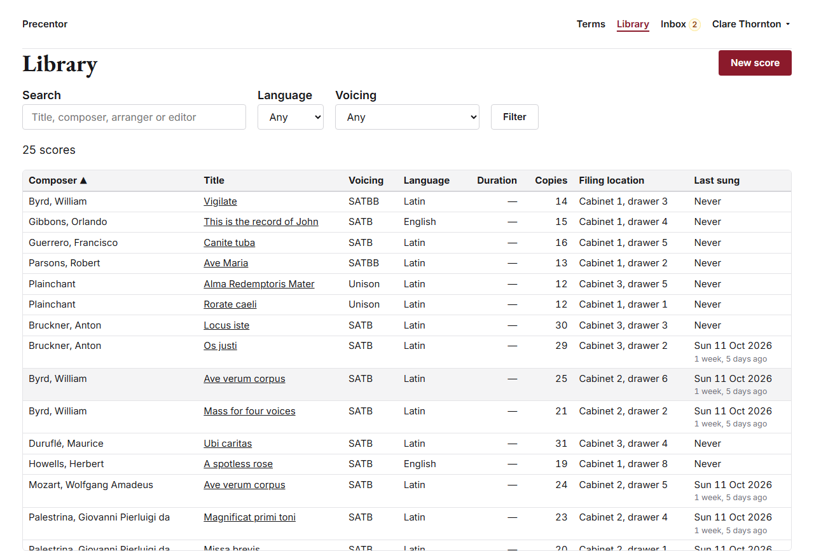

_Figure 4. The library filtered to music suited to Advent, with the last-sung date for each score._

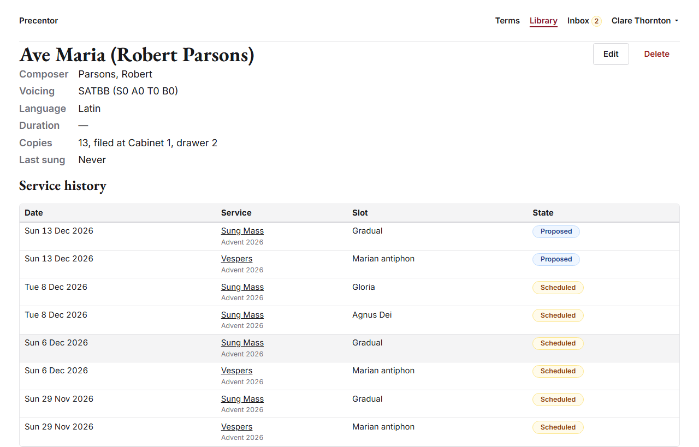

_Figure 5. A score's own page, with its details and where it has been used._

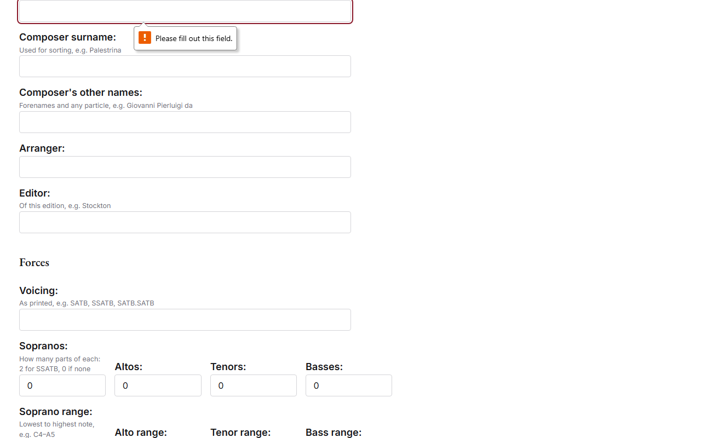

_Figure 6. Adding a score: each missing field is named beside the box that needs it._

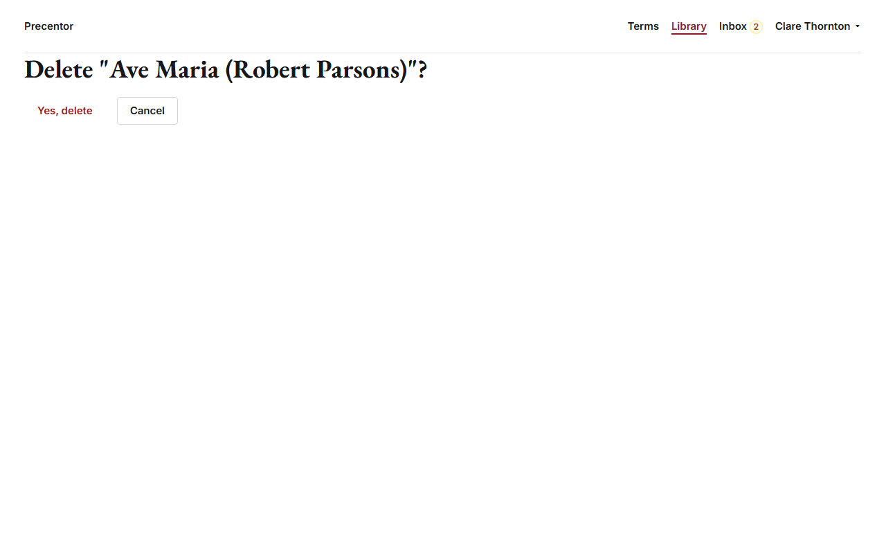

_Figure 7. Deleting always asks first._

### 3.2 Term, Service, and Slots

A **Term** is a named container with a date range (e.g. "Lent 2027").
Any number of terms can be open at once, and the app makes no
assumption about which one is "current": the Terms page shows them by
date, and today's date makes it obvious which ones matter now. (An
earlier idea of an explicit "active term" flag was dropped, because it
would have duplicated information the dates already provide.)

A **Service** belongs to a Term and has a date, a type (Sung Mass,
Vespers, etc.) and a liturgical occasion (see §3.4). It also carries
optional free-text **hymns** and **psalm** fields. These are simple
reference fields, kept outside the propose-and-confirm workflow that
governs slots such as the Mass setting, because hymn numbers and a
psalm reference don't need a shortlist or a confirmation step.

Each service is made up of musical **slots**, added per service:
a Sung Mass might have a _Mass setting_, an _Introit_, an _Offertory
motet_ and a _Communion_; Vespers might have a _Magnificat_ and a motet.
Slot names are free text, because practice varies from church to
church. One choir sings the Propers, another sings a hymn in place of
some of them, and another adds a motet at the Offertory, or sings one
in place of the Responsorial Psalm when the text is the same. Slots can
be added, removed, or marked **N/A** service by service (a special day
might need an extra motet, or have no setting at all, as on Good
Friday).

Each slot has its own **Remove** button. An empty slot goes straight
away; one with pieces proposed asks first, saying how many pieces go
with it, because those pieces and their comments are deleted too.

Slots keep the order they're given, and a new one goes at the end, so
they can be **moved**: dragged by the handle beside the name, or moved
with the Move up and Move down buttons, which work from the keyboard,
on a phone and without JavaScript. While a slot is being dragged,
holding it near the top or bottom of the window scrolls the page, so a
motet can be carried from the end of a long Mass to anywhere in it.

**Slot templates** save adding the usual slots one by one. On a
service's page, a button per template adds its slots in order: **Mass**
(Introit, Kyrie, Gloria, Gradual, Alleluia or Tract, Credo, Offertory,
Sanctus, Agnus Dei, Communion) and **Vespers** (Psalms, Hymn,
Magnificat, Marian antiphon) come ready-made, and a conductor can edit
those or make their own, such as Benediction or a choir's usual Sunday
Mass with its motets. A service uses one template at a time: choosing
a different one asks "Replace the Mass slots with Vespers?" first, then
removes the old slots and adds the new. Any slot with pieces proposed
is kept, so no planning is lost. Applying the same template twice
changes nothing, and afterwards the slots are ordinary slots, to move,
mark N/A or remove like any other.

**In the app.** The conductor plans a term on the Terms page, opens it to see every service and its status, and opens a service to fill its slots.

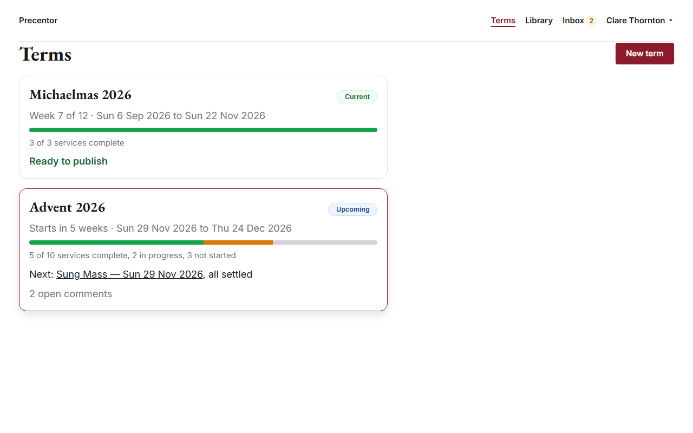

_Figure 8. The Terms page: each term's progress at a glance._

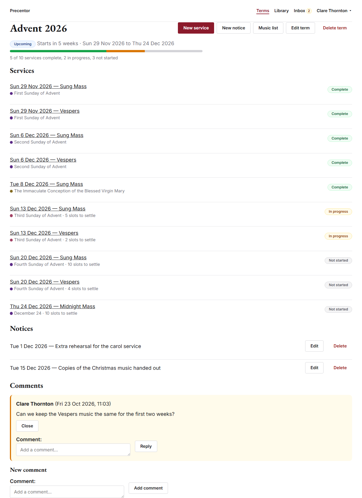

_Figure 9. A term: its services in date order with their status, its notices and its comments._

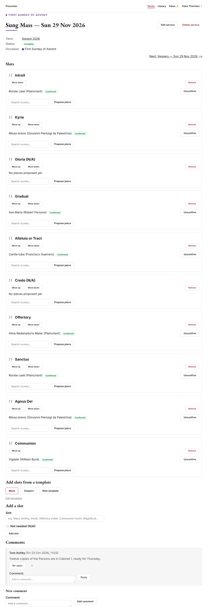

_Figure 10. A service: the occasion worked out from its date, slots added from the Mass template, confirmed pieces and two slots marked N/A._

### 3.3 Proposing and Confirming

Each slot holds a **shortlist of proposed pieces** (e.g. two motets
still being weighed up). Confirmation happens **per piece**, not per
slot or per service, which allows cases like two motets in one service,
or a mixed setting. A confirmed piece can always be **unconfirmed**
again; nothing is a one-way door.

Pieces are proposed from a search box in each slot, with the scores
suited to the service's occasion or season listed first. Without
JavaScript, each slot has a "Propose a piece" link instead, which
opens a short page with one list of scores in the same order. That
keeps the service page small: it carries the library once, not once
for every slot.

Marking a slot **N/A** counts as a planning decision, just as
confirming does. It means "I've considered this and there's nothing
here on purpose", not "nothing has happened yet".

A service's overall status is **derived**, not stored:

- **Not started**: no candidates anywhere
- **In progress**: some slots still only have proposed (unconfirmed) pieces
- **Complete**: every slot is either confirmed or marked N/A

This status powers the Terms page's overview, so a conductor can scan a
term and see at once which services still need attention.

**In the app.** Typing in a slot's search box lists the library, with scores suited to the service ranked first. Choosing one proposes it; Confirm settles it.

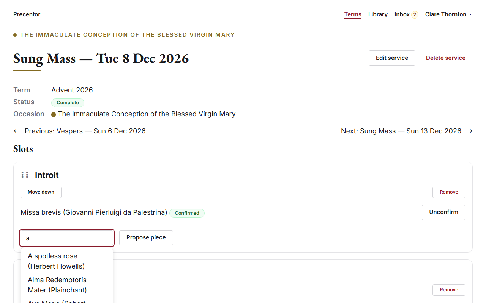

_Figure 11. Proposing a piece from the slot's search box._

### 3.4 Ordo (the Liturgical Calendar)

**Ordo** is this project's name for its liturgical calendar engine. It
follows the Roman calendar: Advent, Christmas, Ordinary Time, Lent, the
Easter Triduum and Easter, with Ordinary Time resuming after Pentecost.
Some occasions are fixed-date (Christmas Day), others are moveable,
calculated relative to Easter (Ash Wednesday, Palm Sunday, Pentecost).
Each term follows either the Ordinary Form or the 1962 Extraordinary
Form calendar, and a single service can override its term's choice,
since some choirs sing both. Services carry a liturgical occasion drawn
from Ordo, which drives both the ranking of suitable scores and the
seasonal colour used in the interface.

Ordo holds the real calendars, not a sample:

- **Both forms.** The Ordinary Form's Sundays, solemnities, feasts,
  obligatory memorials and privileged weekdays, and the 1962
  calendar's days of the first three classes. Optional memorials and
  fourth-class days are left out: a choir is very unlikely to sing for
  one.
- **The church's own country.** On Settings, a conductor chooses the
  General Roman Calendar, England or Wales. England keeps St George as
  a solemnity, for example, and moves Corpus Christi to the Sunday;
  Wales keeps St David. The 1962 calendar has England's and Wales's
  days too.
- **Precedence.** When two days fall together, Ordo works out which is
  kept, by the Church's own tables: a solemnity on a Sunday of Easter
  moves to the Monday, a memorial in Lent is kept only alongside the
  weekday, and in 1962 a feast may be commemorated instead. It works
  this out for any year, from rules, not from a list of dates.
- **Suggestions.** When a service's date is entered, the service form
  suggests the day's celebration, and anything also kept that day, for
  the conductor to choose.
- **One form at a time.** The calendar comes first on the service
  form, and the occasion lists below it then show only that form's
  days, which roughly halves what there is to search. An occasion
  already chosen stays listed whichever form is picked, and without
  JavaScript both forms are listed, with the 1962 days marked "(1962)".

The rules are ported from two open-source projects, romcal (the
Ordinary Form) and Missalemeum (1962), and checked against them for
every day from 2020 to 2040; England's and Wales's 1962 days come from
the Latin Mass Society's Ordo. Where Precentor's answer differs from a
source, the reason is recorded.
[`docs/calendar_plan.md`](docs/calendar_plan.md) has the design and
the checks, and [`docs/acknowledgements.md`](docs/acknowledgements.md)
how each source was used.

### 3.5 Rehearsal Lead-Time (dropped)

An early plan gave each score an optional rehearsal lead-time tag: how
far ahead a piece needs to go into rehearsal, as a more useful signal
than a subjective "difficulty" rating. I dropped it before the build
was finished, because nothing else in the app used or showed it, and it
added a rehearsal-scheduling question the tool doesn't otherwise ask.

### 3.6 "Last Sung"

Derived from service history: the most recent service, on or before
today, in which the piece was confirmed. A piece confirmed for a
future service is scheduled, not sung, so it doesn't count yet. Like a
service's status, it's worked out when the page loads and never
stored, so it can't fall out of step with the planning data.

A choir's history starts long before it begins using Precentor, so
each score can also carry a manual "last sung" date for older records;
the library shows whichever date is later. The library table shows it
as a date with a rough interval ("Sun 4 Oct 2026, 3 weeks ago"), or
"Never". The score's own page lists its **complete history**, every
service it has been proposed or confirmed for, which helps a librarian
or conductor check how often something has been repeated. The same
piece can fill several slots, or repeat across different services and
terms.

## 4. The Public Music List

Modelled on a real example (a termly printed list from a parish
church), the tool produces a formatted document from a term's current
state:

- **Snapshot, not live.** The printed list shows the state at the
  moment it was printed. If things change afterwards (as they sometimes
  do, right up to the day), the printed or shared copy reflects what
  was true then; the app doesn't try to keep copies in step after the
  fact.
- **Latest version only.** The app doesn't archive past versions. Once
  a list has been shared or printed, its life belongs to whoever
  received it; the app is only concerned with "now".
- **Partial lists are allowed.** A term still in progress can produce a
  useful internal draft. In the draft, a slot without a confirmed piece
  is marked **TBC**, so nobody confuses something left out on purpose
  (N/A) with something not yet decided. The distinction matters,
  because a public document should never show an undecided choice as
  if it were settled; the public version leaves those slots out.
- **Newspaper columns by default.** Following the same real example,
  the public list flows its entries down one column and on to the top
  of the next (CSS `columns`, not a hand-built grid), with each
  service's occasion, hymns and psalm alongside it. A site-wide setting
  can switch this to a plain single column instead. The draft always
  uses the simple layout, since it's for spotting what's still TBC, not
  for final presentation.
- **Notices alongside services.** A **notice** puts free text on a
  given date (e.g. "Choir resumes services on 22nd February") in the
  same timeline as the services, for something like half term or a
  retreat that isn't a service with slots of its own.
- **Branding set once.** A single site-settings record (church name,
  crest, house accent colour, and the layout and hymns-and-psalm
  settings above) is set on a conductor-only page and applied to every
  music list, so the details aren't re-entered each term. The crest can
  be a logo, shown at its own shape beside the church's name, or a
  banner across the top that carries the name itself, since churches
  use both. A banner can be cropped in the browser before upload;
  without JavaScript, the raw image can still be uploaded, and the
  server crops it to the same shape instead of rejecting it. The image
  is kept in the database rather than on disk, because a host wipes its
  disk on every deploy.
- **The liturgical accent, reused.** Each entry's left-hand colour
  stripe uses `Service.occasion.colour` in the same way as the service
  page (see §3.4, and the liturgical accent section of
  [`docs/design_system.md`](docs/design_system.md)), falling back to the
  house accent colour when a service has no occasion of its own.

**In the app.** The music list lays out the whole term for the choir and congregation, with the church's name and crest, and prints on paper. A draft view marks slots still to be decided as TBC.

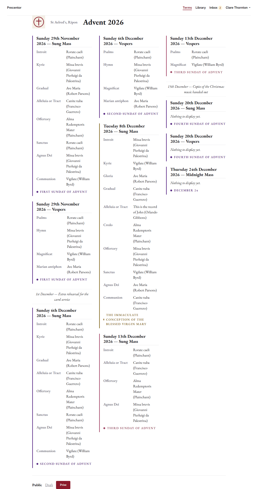

_Figure 12. The public music list for Advent, with Public, Draft and Print at the foot._

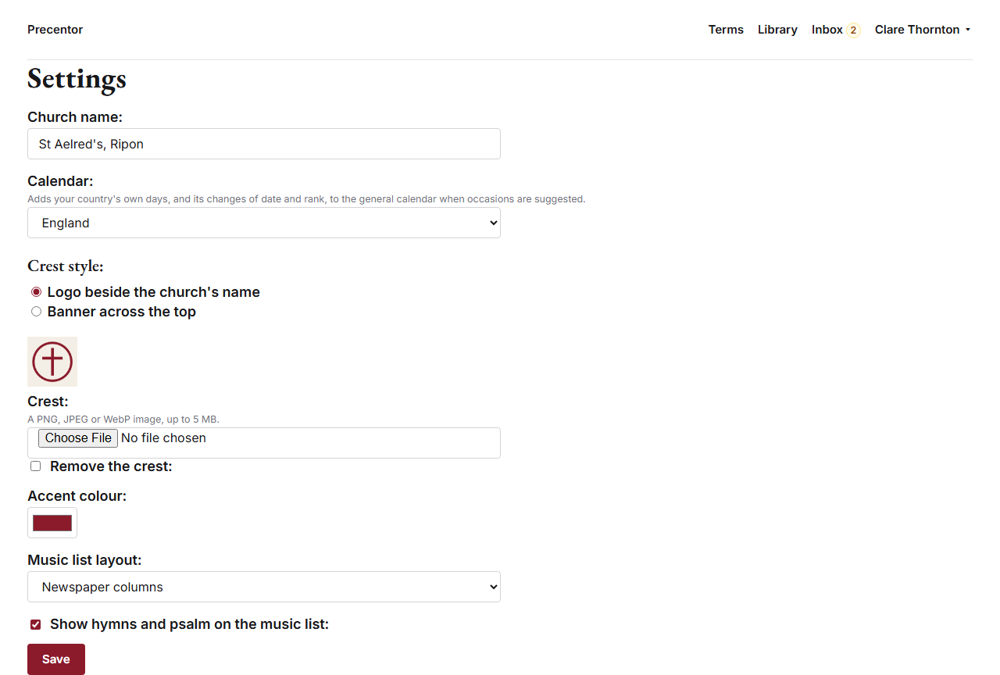

_Figure 13. Settings: the church's name, crest and calendar, which the music list uses._

## 5. Roles and Permissions, Revisited

The roles mirror how the work is divided: **the conductor decides, the
librarian fulfils.** The librarian owns the physical library, while
repertoire decisions (propose, confirm, unconfirm, N/A) stay with the
conductor alone. The librarian can see all of the planning but change
none of it. A viewer, such as a singer or a clergy colleague, can see
everything and join the discussion in the comments, but changes
nothing.

Every rule lives in one place, `accounts/permissions.py`: one small
function per question ("may this person plan?", "may they edit the
library?"). Views ask through a decorator or a mixin, and templates
through a `can` variable, so a button and the page behind it always
agree. Someone signed in who tries something their role doesn't allow
gets a "403 Forbidden" response, rather than being sent back to the
login page, where logging in again would change nothing. A test holds
the whole table of roles against rules, so the code and this section
can't quietly drift apart.

**Accounts.** People sign in with their email address and a password.
Each person belongs to one organisation (a church, a music department
or a school) and holds one role in it, and one of them is its owner,
who looks after its members. I replaced Django's built-in user with
my own model before the database had any tables, because Django can't
swap user models once they exist. The database itself refuses accounts
that make no sense: someone in an organisation without a role, an
owner outside one or who is only a viewer, or a second account for the
same address typed in different capitals. Addresses are stored in
lowercase and sign-in ignores case, so Anne@Example.com and
anne@example.com are one person. A site superuser belongs to no
organisation and gets no powers inside the app; the admin pages are
theirs.

**Registering a church.** Anyone can register their church from the
login page. They give its name, their own name, an email address and a
password, and become its owner and a Conductor, already signed in. The
church starts with its own copies of the Mass and Vespers templates and
the use types Mass, Vespers and General, which it can change without
touching anyone else's. Until it has a term or a score, the Terms page
shows a few first steps, each only if the person's role allows it.
The owner then invites everyone else from the Members page.

**Keeping churches apart.** Every church's scores, terms, services,
templates, use types, comments and settings carry their organisation,
and every page looks only within the signed-in person's own. Someone
who types the address of another church's score or service gets a
"404 Not Found", as if it didn't exist, rather than a "403 Forbidden"
that would admit it does. The liturgical calendar is the one thing
every church shares.

**In the app.** The owner invites people from the Members page. The link is shown once, to send by hand, and the new member joins in the role it names. Anyone without a permission sees a plain explanation, and another church's records simply don't exist for them.

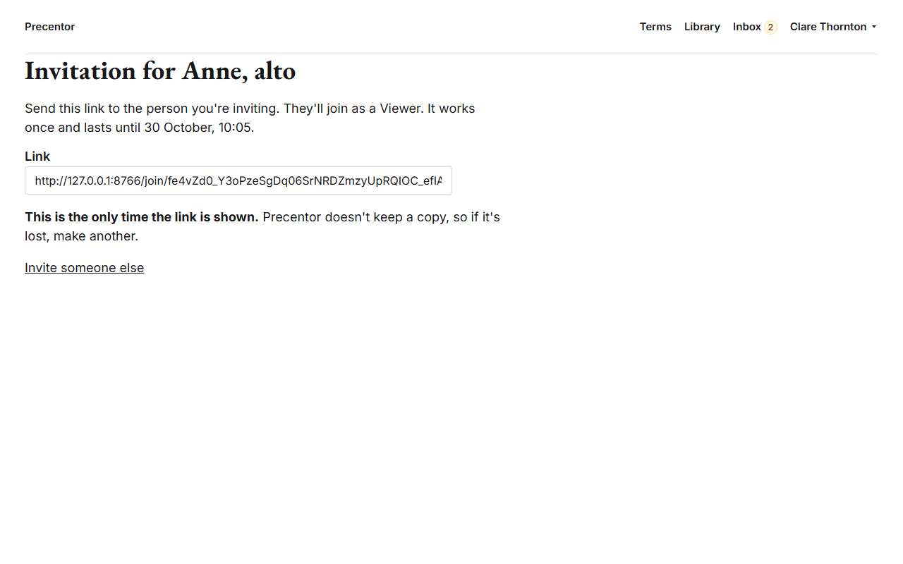

_Figure 14. An invitation link, shown once for the owner to pass on._

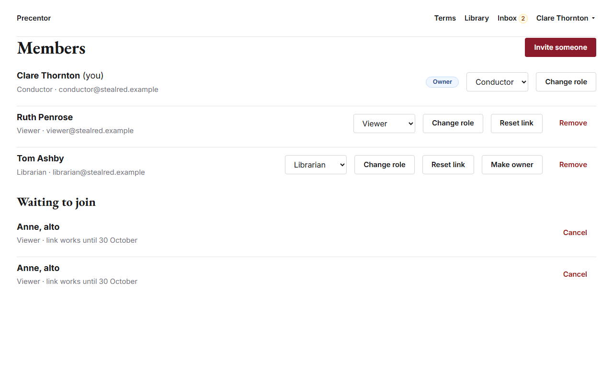

_Figure 15. The Members page as the owner sees it._

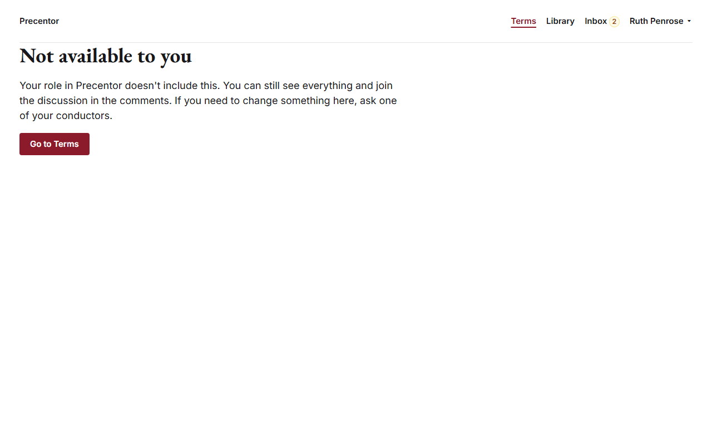

_Figure 16. A Viewer trying to create a term gets a 403 page that says why._

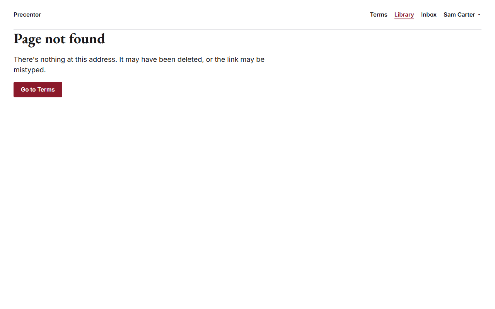

_Figure 17. Someone from another church opening this church's score by its address gets a 404, as if it didn't exist._

## 6. Comment Threads

A small, bounded feature that lets the librarian and conductor discuss
things without leaving the app:

- **Flat structure:** one layer of comments, with replies underneath and
  no nested threading.
- **Authored:** each comment shows its author's name.
- **Open or closed,** and anyone can close or reopen a thread. Only a
  conductor or librarian can delete one, and only once it's closed, so
  a viewer can't erase a discussion other people took part in.
- **Three colour states:** open, open with replies, and closed.
- **Targets:** each service and each term has a comment thread ("is
  this service's shape right?" against "how's this term looking
  overall?"). A question about a particular piece ("do we have enough
  copies of this?") goes in its service's thread; I decided a separate
  thread per piece would be more granular than the conversation needs.
  The link is a single polymorphic relationship (Django's
  `GenericForeignKey`, via `contenttypes`) instead of separate optional
  foreign keys. That keeps the `Comment` model clean, at the cost of
  database-level joins, which is an acceptable trade-off for a "should
  have" feature. The model would still accept a comment on a piece if
  that were ever wanted.
- **Inbox:** every open comment, with no read receipts or @mentions. In
  a close-knit working relationship of two or three people, routing
  attention would be needless complexity.
- Comments share their subject's lifecycle: if a service is deleted,
  its comments go with it. That's a simple default chosen on purpose,
  not an oversight.

This remains a **"should have"**, not core to the MVP.

**In the app.** Open threads from every service and term collect in the Inbox, and the number in the menu shows how many are waiting.

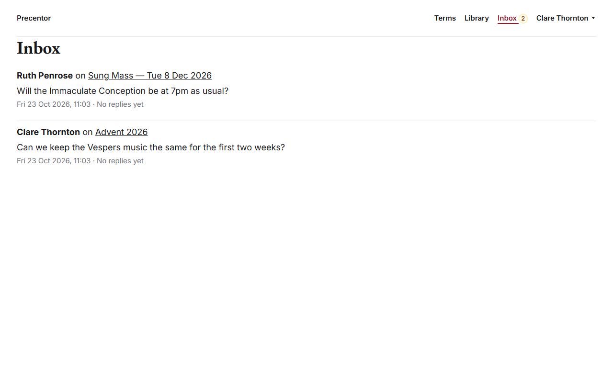

_Figure 18. The Inbox of open threads._

## 7. Scope Discipline (MoSCoW)

**Must have (the spine)**

- Score CRUD (title, composer, arranger, voicing, language, duration)
- Term → Service structure, with slots per service
- Filter scores by voicing
- "Last sung" derived from service history
- Basic liturgical season tagging and filtering

**Should have**

- Full Ordo (Roman liturgical calendar, Ordinary and Extraordinary Form) with moveable feast calculation
- Filter by language
- Physical copy tracking (copies owned, filing location)
- Conductor vs. Librarian roles with distinct permissions
- Comment threads

**Nice to have**

- CCLI/copyright licence reporting export
- Choir roster awareness (auto-filtering by available voice parts)
- Smart repertoire suggestions (voicing + season + not-sung-recently)
- Bulk CSV import of a legacy library

## 8. Out of Scope

- One account belonging to several organisations. Each person
  belongs to one church; someone who sings in two would need two
  accounts.
- Calendars other than the Roman one, such as the Church of England's
  Common Worship and Book of Common Prayer. Precentor originally
  modelled the Catholic and Church of England calendars side by side,
  with a tradition chosen per term. I narrowed it to the Catholic
  calendar because one church follows one tradition, so a per-term
  choice added a field to every form, a second set of seed data and a
  second set of tests without helping any real user. A second tradition
  remains possible future work, most simply as each church's own setting, not
  a per-term choice.
- A history or archive of past music lists.
- An "active term" flag (the dates already show which term is current).
- Nested comment replies.
- Precise double-choir voicing (e.g. which parts belong to which of two
  choirs). It's recorded accurately in the free-text voicing field, but
  not as structured data that can be searched.
- Per-slot permissions, e.g. a parish secretary who can edit only a
  "Hymns" slot while the conductor controls the Mass setting and
  motets. In some churches hymn choice does sit outside the conductor's
  remit, but modelling that would mean permission checks keyed to
  individual slot names instead of a fixed Conductor and Librarian
  split, a much bigger structural change than the MVP calls for. The
  three roles (Conductor: full access; Librarian: the library, with
  planning read-only; Viewer: read-only, apart from comments) cover the
  common case.
- Ordo as a liturgical reference tool. Ordo's job is to name, date and
  colour occasions, for ranking repertoire and labelling services. It
  doesn't model readings, psalms, propers or rubrical detail (e.g.
  whether the Gloria is said), even if it later covers other calendars.
  That's a separate, mature domain with authoritative tools already
  serving it well, and duplicating it would mean building a different
  application inside Precentor.
- Fully customisable music list layouts (drag-and-drop design, arbitrary
  field order or typography). Precentor ships one default layout and a
  small set of high-value settings (column style, house accent colour,
  crest, hymns and psalm), not an open-ended design tool. A church whose
  house style differs further still has full access to its planning
  data; the limit is only on the built-in printed output.

Each of these is noted here so that scope decisions read as choices,
not oversights, when an assessor reads this document.

## 9. Supporting Documents

- [`docs/user_stories.md`](docs/user_stories.md): user stories for the
  conductor, the librarian and the site owner (the church), used to
  check the finished application against its original intent.
- [`docs/erd.mmd`](docs/erd.mmd) (Mermaid source, which GitHub renders):
  the entity relationship diagram for Score, Term, Service, Service
  Role, Role Piece, Ordo (Liturgical Occasion), Organisation, User and
  Comment. Its
  notes cover two simplifications: a slot template copies its names
  into a service's slots, so the slots themselves keep no link to it,
  and Comment's
  polymorphic relationship is drawn as
  three edges for readability, though it's a single Django
  `GenericForeignKey` in the code.
- [`docs/models_plan.md`](docs/models_plan.md): the Django app breakdown
  and field-level model plan that turned the ERD into code. I wrote it
  before scaffolding the project and updated it as the build turned up
  corrections (the fixed-date fix and the colour `choices` decision, for
  example).
- [`docs/design_system.md`](docs/design_system.md): the visual design
  system, covering CUBE CSS, cascade layers (not `@import`), design
  tokens, self-hosted typography and the liturgical accent.
- [`docs/calendar_plan.md`](docs/calendar_plan.md): the design of Ordo's
  real calendars and their order of precedence, what was built, and
  how it was checked against its sources.
- [`docs/ordo_plan.md`](docs/ordo_plan.md): the earlier design of the
  occasion suggestions and the score suitability tags.
- [`docs/score_import_plan.md`](docs/score_import_plan.md): the design
  for importing a library from a spreadsheet, not yet built.
- [`docs/overhaul_plan.md`](docs/overhaul_plan.md): the overhaul before
  deployment, phase by phase, with a log of what each phase found.
- [`docs/acknowledgements.md`](docs/acknowledgements.md): every outside
  source I've drawn on (calendar data and rules, liturgical documents,
  design methods, typefaces and packages), what I used from each, and
  its licence.
- [`docs/blocks_backlog.md`](docs/blocks_backlog.md): the running log of
  Blocks found while laying out every page, each built only once the
  same pattern had appeared more than once, instead of being guessed at
  up front.

## 10. Why This Project

Precentor comes from my own experience as a church choral conductor. It
addresses a specific, recurring chore (planning repertoire and
producing music lists by hand) for a clear audience: a conductor working
alongside a librarian or music administrator. Each design decision
above has a concrete reason behind it, drawn from how church music
planning actually works, instead of a generic "library system"
template.

## 11. Acknowledgements

I'm grateful to everyone whose work Precentor builds on. The Ordinary
Form calendar's date rules are a Python port of
[romcal](https://github.com/romcal/romcal)'s (MIT licence), checked
against romcal's own calendars, and its order of precedence follows the
Church's General Norms for the Liturgical Year and the Calendar. The
1962 calendar is a port of
[Missalemeum](https://github.com/mmolenda/Missalemeum)'s rules (MIT
licence), and its days for England and Wales come from the Latin Mass
Society's Ordo. The
stylesheets follow Andy Bell's CUBE CSS, with layouts based on Every
Layout by Heydon Pickering and Andy Bell, and fluid scales from
Utopia. The typefaces are EB Garamond and Inter, both under the SIL
Open Font License. [`docs/acknowledgements.md`](docs/acknowledgements.md)
lists every source in full, with what I took from each and how, and
my thanks to each.


## 12. Deployment

Precentor runs on [Render](https://render.com), described in full by
`render.yaml` at the root of the repository (a Render "Blueprint"). The
`Procfile` follows the course's Heroku convention, but the deployment
itself is described by `render.yaml`. It creates a project called
Precentor with a Production environment holding:

- **The web service**, on Render's free plan, in Frankfurt. It sleeps
  after 15 minutes without visitors and takes about a minute to wake,
  which is fine for a project with a handful of users. Each deploy
  installs the requirements, collects the static files, runs the
  migrations and loads the liturgical calendar, then starts the site
  with gunicorn. The free plan has no separate pre-deploy step, so all
  of that happens in the build.
- **The database**, Postgres 17 on the smallest paid plan, because a
  free Render database is deleted 30 days after it's made. Its allow
  list is empty, so only Render's own services can reach it.

The settings read everything a host provides from the environment.
Render generates `SECRET_KEY` and supplies `DATABASE_URL` and the
site's own address, so nothing needs typing into the dashboard. With
`DEBUG` off, the site is served only over HTTPS with secure cookies,
and `manage.py check --deploy` is clean.

To deploy it from a fresh copy of the repository:

1. In the Render dashboard, choose **New**, then **Blueprint**, connect
   GitHub if asked, and pick this repository and its `main` branch.
2. Check the list of what will be created (the project, the web service
   and the database) and apply it. The paid database needs a payment
   card on the account.
3. Watch the web service's log. The build ends with the calendar being
   loaded (lines such as `general_roman: 223 added`), then "Your
   service is live".
4. Make the first superuser from your own computer, since the free plan
   has no shell on Render. Add your IP address to the database's allow
   list, copy its External Database URL, and in the project folder with
   the virtual environment active run:

   ```powershell
   $env:DATABASE_URL = "the External Database URL"
   python manage.py createsuperuser
   Remove-Item Env:DATABASE_URL
   ```

   It asks only for an email address and a password. Then take your IP
   address off the allow list again.
5. Sign in to `/admin/` as the superuser, add an organisation, and add
   your own account to it as a Conductor, ticking "is owner". Sign in
   with that account from then on; the superuser only looks after the
   site.

Later deploys happen by themselves whenever `main` changes on GitHub.
After one, it's worth checking that the login page loads, that `http://`
sends you to `https://`, and that the crest still shows on Settings.

## 13. Data model

Six apps hold the data: `accounts` (organisations, people,
invitations), `library` (scores), `planning` (terms, services, slots,
pieces, templates, notices), `ordo` (the liturgical calendar and use
types), `comments` and `core` (each church's settings). The reasoning
behind each choice is in [`docs/models_plan.md`](docs/models_plan.md).

### Relationships

- An **organisation** (a church, school or music department) has many
  users, invitations, scores, terms, slot templates and use types, and
  one settings row.
- A **term** has many services and notices. A **service** has many
  slots (`ServiceRole`), and a **slot** has many proposed pieces
  (`RolePiece`), each pointing at one score.
- A service has one main **liturgical occasion** and any number of
  additional ones. Occasions belong to a **liturgical season**. A score
  can be tagged as suited to occasions, seasons and use types, which
  ranks it higher when a piece is proposed.
- **Comments** attach to a term, a service or a piece through one
  generic relation (`content_type` and `object_id`), and a reply points
  at the comment it answers.
- The **liturgical calendar** (occasions and seasons) is shared by every
  church and loaded by `manage.py load_calendar`. Everything else
  belongs to one organisation. Services, notices, slots, pieces and
  comments copy their organisation from what they belong to when
  they're saved, so every query can be limited to one church the same
  way.
- A service's status and a score's "last sung" date are worked out when
  they're needed, never stored.

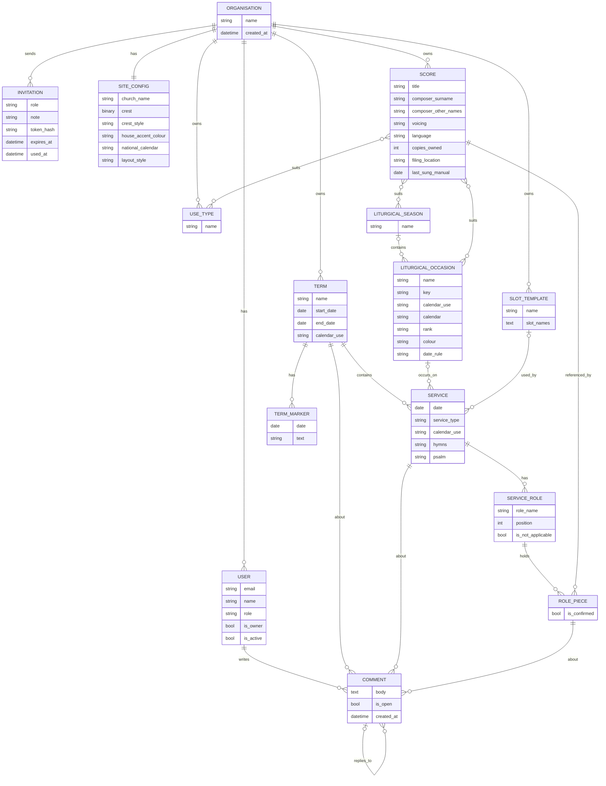

The same diagram is in [`docs/erd.mmd`](docs/erd.mmd).

### Fields

Every model also has an automatic `id` primary key.

**accounts.Organisation**

| Field        | Type          | Constraints | Purpose                                 |
| ------------ | ------------- | ----------- | --------------------------------------- |
| `name`       | CharField     | max 200     | The church, school or department's name |
| `created_at` | DateTimeField | set on save | When it registered                      |

**accounts.User** (replaces Django's user; signs in by email)

| Field          | Type         | Constraints                    | Purpose                                       |
| -------------- | ------------ | ------------------------------ | --------------------------------------------- |
| `email`        | CharField    | unique, stored lowercase       | Sign-in name                                  |
| `name`         | CharField    | optional, max 150              | Shown in the app                              |
| `organisation` | ForeignKey   | optional, to Organisation      | Their church; empty only for a site superuser |
| `role`         | CharField    | Conductor, Librarian or Viewer | What they may do                              |
| `is_owner`     | BooleanField | default False                  | Manages members, invitations and reset links  |
| `is_active`    | BooleanField | default True                   | False once the owner removes them             |

It also has Django's own `password`, `last_login`, `is_staff`,
`is_superuser` and `date_joined`.

**accounts.Invitation**

| Field                | Type                      | Constraints                    | Purpose                                                    |
| -------------------- | ------------------------- | ------------------------------ | ---------------------------------------------------------- |
| `organisation`       | ForeignKey                | to Organisation                | The church being joined                                    |
| `role`               | CharField                 | Conductor, Librarian or Viewer | The role the person will have                              |
| `note`               | CharField                 | optional, max 100              | Who it's for, to tell invitations apart                    |
| `token_hash`         | CharField                 | unique, 64 characters          | SHA-256 of the link's secret; the secret itself isn't kept |
| `created_by`         | ForeignKey                | to User, set null on delete    | Who made it                                                |
| `created_at`         | DateTimeField             | set on save                    | When it was made                                           |
| `expires_at`         | DateTimeField             | required                       | Seven days after it was made                               |
| `used_at`, `used_by` | DateTimeField, ForeignKey | optional                       | When and by whom it was used; it works once                |

**library.Score**

| Field                                                       | Type                      | Constraints           | Purpose                              |
| ----------------------------------------------------------- | ------------------------- | --------------------- | ------------------------------------ |
| `organisation`                                              | ForeignKey                | to Organisation       | The church's library it's in         |
| `title`                                                     | CharField                 | max 200               | Title                                |
| `composer_surname`                                          | CharField                 | max 100               | Used for sorting                     |
| `composer_other_names`                                      | CharField                 | optional, max 100     | Forenames and any particle           |
| `arranger`, `editor`                                        | CharField                 | optional, max 200     | Arranger, and editor of this edition |
| `voicing`                                                   | CharField                 | max 50                | As printed, e.g. SATB or SSATB       |
| `soprano_parts`, `alto_parts`, `tenor_parts`, `bass_parts`  | PositiveSmallIntegerField | default 0             | How many parts of each voice         |
| `language`                                                  | CharField                 | max 50                | e.g. Latin, English                  |
| `copies_owned`                                              | PositiveIntegerField      | default 0             | How many copies the church has       |
| `filing_location`                                           | CharField                 | optional, max 100     | Where the copies are kept            |
| `duration_minutes`                                          | PositiveIntegerField      | optional              | Length                               |
| `background`, `notes`                                       | TextField                 | optional              | The piece's history; rehearsal notes |
| `range_soprano`, `range_alto`, `range_tenor`, `range_bass`  | CharField                 | optional, max 20      | Lowest to highest note               |
| `last_sung_manual`                                          | DateField                 | optional              | History from before Precentor        |
| `suited_use_types`                                          | ManyToMany                | to UseType            | Kinds of service it suits            |
| `suited_seasons`                                            | ManyToMany                | to LiturgicalSeason   | Seasons it suits                     |
| `suited_occasions`                                          | ManyToMany                | to LiturgicalOccasion | Particular days it suits             |

**planning.Term**

| Field                    | Type       | Constraints                    | Purpose                            |
| ------------------------ | ---------- | ------------------------------ | ---------------------------------- |
| `organisation`           | ForeignKey | to Organisation                | Whose term                         |
| `name`                   | CharField  | max 100                        | e.g. Michaelmas 2026               |
| `start_date`, `end_date` | DateField  | required                       | The term's dates                   |
| `calendar_use`           | CharField  | Ordinary or Extraordinary Form | Which calendar its services follow |

**planning.Service**

| Field                  | Type       | Constraints                     | Purpose                          |
| ---------------------- | ---------- | ------------------------------- | -------------------------------- |
| `term`                 | ForeignKey | to Term                         | The term it's in                 |
| `organisation`         | ForeignKey | copied from the term            | Whose service                    |
| `date`                 | DateField  | required                        | When                             |
| `service_type`         | CharField  | max 50                          | e.g. Sung Mass, Vespers          |
| `occasion`             | ForeignKey | optional, to LiturgicalOccasion | The main day; sets the colour    |
| `additional_occasions` | ManyToMany | to LiturgicalOccasion           | Other days it also marks         |
| `calendar_use`         | CharField  | optional                        | Overrides the term's calendar    |
| `hymns`, `psalm`       | CharField  | optional                        | Numbers for the music list       |
| `slot_template`        | ForeignKey | optional, to SlotTemplate       | The template its slots came from |

**planning.TermMarker** (a "notice" in the app)

| Field          | Type       | Constraints          | Purpose                     |
| -------------- | ---------- | -------------------- | --------------------------- |
| `term`         | ForeignKey | to Term              | The term it's in            |
| `organisation` | ForeignKey | copied from the term | Whose notice                |
| `date`         | DateField  | required             | Where it falls in the term  |
| `text`         | CharField  | max 200              | e.g. Half term, no services |

**planning.ServiceRole** (a "slot" in the app)

| Field               | Type                 | Constraints             | Purpose                          |
| ------------------- | -------------------- | ----------------------- | -------------------------------- |
| `service`           | ForeignKey           | to Service              | The service it's in              |
| `organisation`      | ForeignKey           | copied from the service | Whose slot                       |
| `role_name`         | CharField            | max 50                  | e.g. Introit, Offertory motet    |
| `is_not_applicable` | BooleanField         | default False           | Marked N/A, so it needs no piece |
| `position`          | PositiveIntegerField | default 0               | Order within the service         |

**planning.RolePiece** (a proposed piece)

| Field          | Type         | Constraints          | Purpose                    |
| -------------- | ------------ | -------------------- | -------------------------- |
| `service_role` | ForeignKey   | to ServiceRole       | The slot it's proposed for |
| `organisation` | ForeignKey   | copied from the slot | Whose piece                |
| `score`        | ForeignKey   | to Score             | The music                  |
| `is_confirmed` | BooleanField | default False        | Proposed or confirmed      |

**planning.SlotTemplate**

| Field          | Type       | Constraints                      | Purpose                     |
| -------------- | ---------- | -------------------------------- | --------------------------- |
| `organisation` | ForeignKey | to Organisation                  | Whose template              |
| `name`         | CharField  | max 50, unique within the church | e.g. Mass, Vespers          |
| `slot_names`   | TextField  | required                         | One slot per line, in order |

**ordo.LiturgicalOccasion** (shared by every church)

| Field                          | Type       | Constraints                    | Purpose                                |
| ------------------------------ | ---------- | ------------------------------ | -------------------------------------- |
| `name`, `key`                  | CharField  | key unique within its calendar | Display name and stable identifier     |
| `calendar_use`                 | CharField  | Ordinary or Extraordinary Form | Which form of the rite                 |
| `calendar`                     | CharField  | general, England or Wales      | General or national calendar           |
| `rank`, `precedence`, `colour` | CharField  | optional, fixed choices        | How it ranks, and its liturgical colour |
| `season`                       | ForeignKey | optional, to LiturgicalSeason  | The season it falls in                 |

Its date is worked out each year from `date_rule`, `date_rule_args`,
`date_offset_days`, `fixed_month`, `fixed_day`, `easter_offset_days`,
`is_moveable` and `transfers`; `is_proper_of_time` and
`shares_with_memorials` decide what happens when two days fall
together.

**ordo.LiturgicalSeason** (shared): `name` (CharField, max 50).

**ordo.UseType**: `organisation` (ForeignKey) and `name` (CharField,
max 50), such as Mass, Vespers or General. Each church has its own.

**comments.Comment**

| Field                       | Type                             | Constraints            | Purpose                               |
| --------------------------- | -------------------------------- | ---------------------- | ------------------------------------- |
| `author`                    | ForeignKey                       | to User                | Who wrote it                          |
| `organisation`              | ForeignKey                       | copied from its target | Whose comment                         |
| `content_type`, `object_id` | ForeignKey, PositiveIntegerField | generic relation       | The term, service or piece it's about |
| `parent`                    | ForeignKey                       | optional, to Comment   | The comment it replies to             |
| `body`                      | TextField                        | required               | The text                              |
| `is_open`                   | BooleanField                     | default True           | Closed once resolved                  |
| `created_at`                | DateTimeField                    | set on save            | When                                  |

**core.SiteConfig** (each church's settings)

| Field                                  | Type                   | Constraints                        | Purpose                                 |
| -------------------------------------- | ---------------------- | ---------------------------------- | --------------------------------------- |
| `organisation`                         | OneToOneField          | to Organisation                    | One settings row per church             |
| `church_name`                          | CharField              | optional, max 200                  | Heading of the music list               |
| `crest`, `crest_type`, `crest_version` | BinaryField, CharField | optional                           | The crest image, kept in the database   |
| `crest_style`                          | CharField              | logo or banner                     | How the crest is shown                  |
| `house_accent_colour`                  | CharField              | hex colour, checked by a validator | Colour for services without an occasion |
| `national_calendar`                    | CharField              | general, England or Wales          | Which national days are added           |
| `layout_style`                         | CharField              | columns or simple                  | Music list layout                       |
| `show_hymns_psalm`                     | BooleanField           | default True                       | Whether the music list shows them       |

### Rules the database enforces

- A user has an organisation and a role together, or neither (a
  superuser has neither).
- An owner belongs to an organisation, and is a Conductor or a
  Librarian, never a Viewer.
- An organisation has at most one owner.
- Email addresses are unique whatever their capitals.
- Slot template names are unique within each church.
- An occasion's key is unique within its calendar.
- An invitation's stored fingerprint is unique.

## 14. Screenshots: phones, dark mode and the keyboard

The figures above sit in the sections they illustrate. These show the same app on a phone, in dark mode, and used from the keyboard.

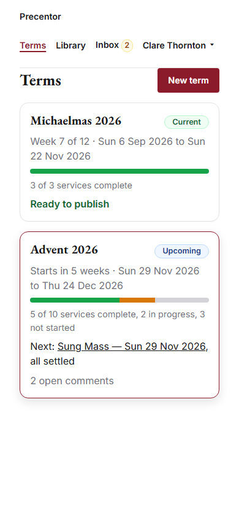

_Figure 19. The Terms page on a phone._

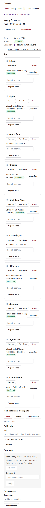

_Figure 20. A service on a phone._

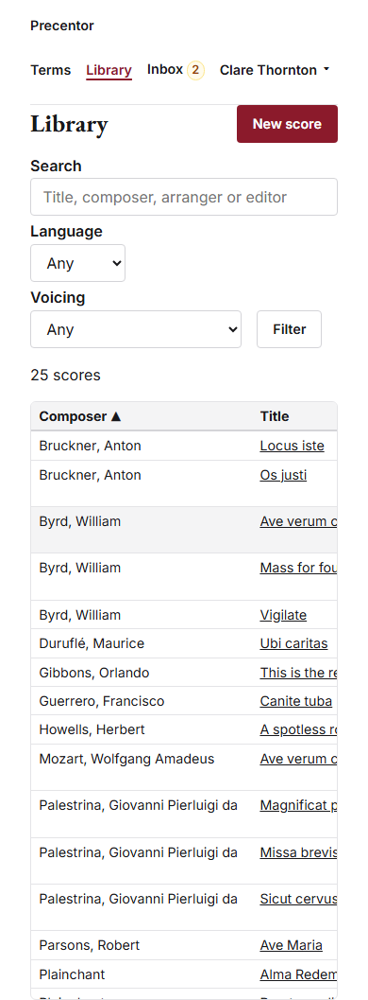

_Figure 21. The library on a phone; the table scrolls within its own box rather than widening the page._

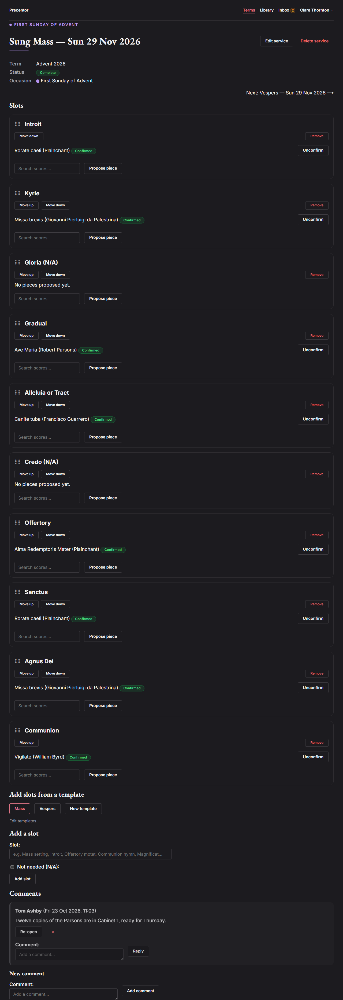

_Figure 22. A service in dark mode, which follows the device's setting or the choice in the user menu._

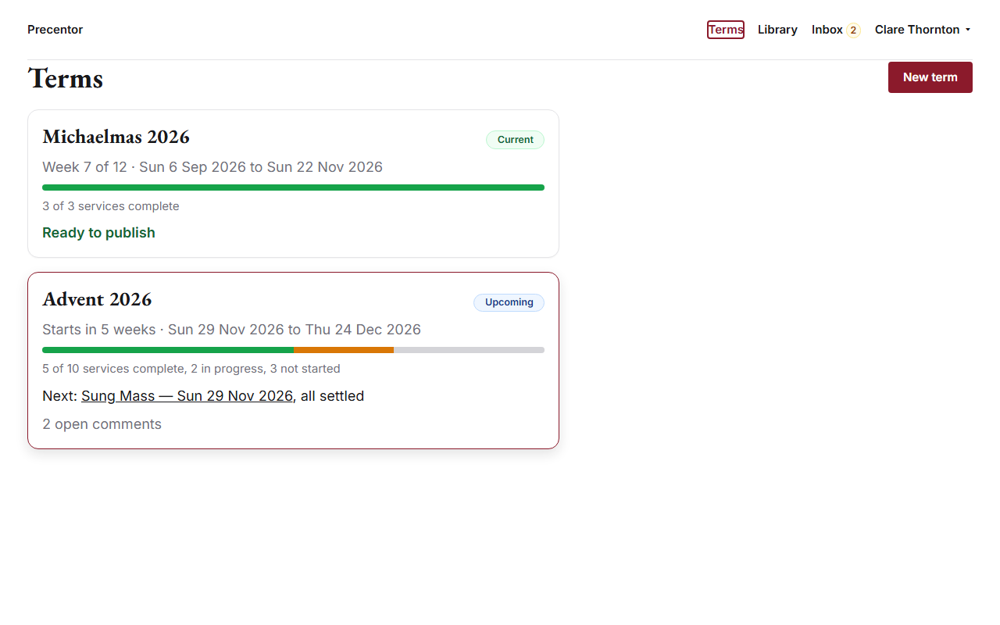

_Figure 23. Keyboard focus: links and buttons show an outline when reached with Tab._

### How the screenshots were made

Every image comes from an invented church, St Aelred's, Ripon, with
invented people, so no real church or person appears. I made them with
two scripts in `tools/`, against a separate SQLite file rather than my
development database:

1. `settings.py` reads the database from `DATABASE_URL`, so I set it for
   one PowerShell session:
   `$env:DATABASE_URL = "sqlite:///screenshots.sqlite3"`. Everything run
   in that session uses `screenshots.sqlite3`, which git ignores.
2. `python tools/seed_demo.py` migrates that file, loads the liturgical
   calendar into it and builds the church through the app's own
   `create_organisation()` and models: three people, 25 scores, a past
   term and an Advent term with services in every state, notices,
   comments and a crest drawn in code.
3. `python manage.py runserver 8766` serves it.
4. `python tools/take_screenshots.py`, in a second terminal with the same
   `DATABASE_URL`, drives Chromium through Playwright (already used for
   the browser tests). It registers a new church for Figures 1 to 3,
   signs in as the demo Conductor and Viewer for the rest, and saves
   each page at 1280 by 800 or, for the phone figures, 390 by 844.
   Images over 300 KB are reduced to 256 colours.
5. My local `.env` turns `DEBUG` on, which shows Django's debug page in
   place of the 404 page, so for Figure 17 the script renders the page
   with `DEBUG` off through Django's test client and photographs that.

## 15. Features and CRUD

Each cell names the page, or the URL name in that app's `urls.py`, that
does it. Every page is limited to the signed-in person's own church, and
the role column in §2 says who may use each one.

| Model                       | Create                                                    | Read                                               | Update                                                                                          | Delete                                                        | Locate                                                                     |
| --------------------------- | --------------------------------------------------------- | -------------------------------------------------- | ----------------------------------------------------------------------------------------------- | ------------------------------------------------------------- | -------------------------------------------------------------------------- |
| Organisation                | Sign-up page (`signup`)                                   | Its name on every page and the music list          | Church name on Settings (`site_config_update`)                                                  | not available (admin only)                                    | not needed: everyone sees only their own                                   |
| User                        | Joining by invitation (`join`); sign-up for the owner     | Members page (`member_list`)                       | Role (`change_role`), owner (`make_owner`), password by reset link (`reset_link`)               | Removed, not deleted (`remove`), and brought back (`restore`) | Members page                                                               |
| Invitation                  | Invite someone (`invite`)                                 | Link shown once (`invitation_link`); Members page  | not available (cancel and make another)                                                         | Cancel (`invitation_cancel`)                                  | Members page, "Waiting to join"                                            |
| Score                       | Add score (`score_create`)                                | Library (`score_list`), score page (`score_detail`) | Edit (`score_update`)                                                                          | Delete, after a confirmation (`score_delete`)                 | Search box, Language, Voicing, Suitable-for filters and sortable columns   |
| Term                        | New term (`term_create`)                                  | Terms page (`term_list`), term page (`term_detail`) | Edit (`term_update`)                                                                           | Delete, after a confirmation (`term_delete`)                  | Terms page, current and upcoming first, past folded away                   |
| Service                     | New service (`service_create`), occasion suggested from the date | Service page (`service_detail`), term page  | Edit (`service_update`)                                                                         | Delete, after a confirmation (`service_delete`)               | Term page in date order; previous and next links on each service           |
| Notice (`TermMarker`)       | New notice (`marker_create`)                              | Term page and music list                           | Edit (`marker_update`)                                                                          | Delete (`marker_delete`)                                      | Term page                                                                  |
| Slot (`ServiceRole`)        | Add a slot (`add_role`) or from a template (`apply_template`) | Service page                                   | Move (`move_slot`), drag to reorder (`reorder_slots`), mark N/A when adding                     | Remove (`remove_slot`), asking first if it has pieces         | Service page                                                               |
| Piece (`RolePiece`)         | Propose a piece (`add_piece`)                             | Service page, score page history, music list       | Confirm and unconfirm (`toggle_confirm`)                                                        | not available on its own (removed with its slot)              | Service page; the score page lists where each score was used               |
| Slot template               | New template (`slot_template_create`)                     | Templates page (`slot_template_list`)              | Edit (`slot_template_update`)                                                                   | Delete (`slot_template_delete`)                               | Templates page; buttons on each service                                    |
| Use type                    | Typed on the score form                                   | Score page; Suitable-for filter                    | not available                                                                                   | not available                                                 | Library filter                                                             |
| Comment                     | Comment or reply (`add_comment`)                          | Inbox (`inbox`); each term, service and piece      | Close and reopen (`toggle_close`); the text can't be edited                                     | Delete a closed thread (`delete_comment`)                     | Inbox of open threads; the count in the menu                               |
| Settings (`SiteConfig`)     | Made with the church                                      | Settings page; the music list                      | Settings (`site_config_update`)                                                                 | not available                                                 | not needed: one per church                                                 |
| Liturgical occasion, season | Loaded by `manage.py load_calendar`                       | Service pages, occasion menus, the music list      | not available (shared reference data)                                                           | not available                                                 | The service form suggests the day's occasions from its date                |

### Validation and feedback

- **Form errors** appear beside the field they belong to, and Django
  marks that field `aria-invalid`, which screen readers announce and the
  styles outline in red. Forms check what the database would refuse, such
  as a template name already used in the church or an address already
  registered, so the message is plain rather than a server error.
- **Success and warning messages** appear after an action, such as
  "Ben Jonson is now a Librarian." or "That invitation has already been
  used or cancelled.", shown at the top of the next page.
- **Deleting asks first.** Scores, terms, services, notices, templates,
  invitations and members each have a confirmation page. Removing a slot
  that has pieces asks in a dialog with JavaScript, or on a page
  without. Going Back to a confirmation page for something already deleted leads
  to its list with a message, not an error.
- **Permissions** give a "Not available to you" page (403) that says
  why, and another church's records give "Page not found" (404).

## 16. Security

- **Secrets stay out of the repository.** `SECRET_KEY`, the database
  address and the allowed hosts are read from environment variables. A
  local `.env` file supplies them in development, and `.env` is ignored
  by git. If `SECRET_KEY` is missing the site refuses to start, with a
  message saying so, rather than running with a default.
- **`DEBUG` is off unless it's switched on.** It's only on when the
  environment says `DEBUG=True`, so a deploy that forgets it is safe.
- **HTTPS once deployed.** With `DEBUG` off, plain `http://` requests are
  redirected to `https://`, the session and CSRF cookies are only sent
  over HTTPS, and browsers are told through HSTS to use HTTPS for this
  site. `python manage.py check --deploy` reports no issues.
- **Forms are protected against cross-site requests** by Django's CSRF
  middleware: every form that changes something posts a CSRF token,
  including the ones JavaScript sends.
- **One permissions module.** Every check of who may do what lives in
  `accounts/permissions.py`, used by views, by a decorator and mixin,
  and by templates through `can`, so a button and the page behind it
  always agree. A test holds the whole roles table from §2 against those
  checks.
- **Each church only reaches its own data.** Every query on a church's
  data is limited to the signed-in person's organisation, which comes
  from their account, never from the address or a form. Opening another
  church's record by its address gives a 404, not a 403, so its
  existence isn't confirmed. Forms only offer, and only accept, the
  church's own scores, use types and templates.
- **Passwords** are stored with Django's password hashers and checked
  against its validators: at least eight characters, not all numbers,
  not a common password and not too like the person's name or email.
- **Invitations work once and expire after a week.** Only a SHA-256
  fingerprint of each link's secret is stored, so the database can't be
  used to make working links. Reset links are Django's own signed
  tokens, which stop working once used, once the person signs in, or
  after three days.
- **Removing someone** switches their account off, which signs them out
  on their next request.

## 17. Running it locally

These steps are for Windows with PowerShell; on macOS or Linux, activate
the virtual environment with `source venv/bin/activate` instead. You
need Python 3.14 and git.

1. Clone the repository and go into it:

   ```powershell
   git clone https://github.com/StockoL/precentor.git
   cd precentor
   ```

2. Create and activate a virtual environment, then install the
   requirements:

   ```powershell
   python -m venv venv
   venv\Scripts\Activate.ps1
   pip install -r requirements.txt
   ```

3. Create a file called `.env` in the repository's root folder with a
   secret key of your own and `DEBUG` switched on:

   ```
   SECRET_KEY=any-long-random-string
   DEBUG=True
   ```

4. Set up the database, which is a local SQLite file unless
   `DATABASE_URL` says otherwise, and load the liturgical calendar:

   ```powershell
   python manage.py migrate
   python manage.py load_calendar
   ```

5. Optionally make a superuser for the admin pages, then start the site:

   ```powershell
   python manage.py createsuperuser
   python manage.py runserver
   ```

   Open http://127.0.0.1:8000/, choose **Register** and register a
   church to start using it.

6. Run the tests:

   ```powershell
   python manage.py test
   ```

   The browser tests use Playwright, which isn't in `requirements.txt`
   because the site doesn't need it to run. Install it once with
   `pip install playwright` and `playwright install chromium`.

## 18. Environment variables

Everything below is read in `precentor_project/settings.py`.

| Variable                   | What it does                                                                                     | Default                               |
| -------------------------- | ------------------------------------------------------------------------------------------------ | ------------------------------------- |
| `SECRET_KEY`               | Django's signing key, for sessions, CSRF and reset links                                         | none: the site won't start without it |
| `DEBUG`                    | `True` turns on Django's debug pages and turns off the HTTPS settings; anything else leaves it off | off                                 |
| `DATABASE_URL`             | Which database to use, as a URL, read by `dj-database-url`                                       | `sqlite:///db.sqlite3`                |
| `ALLOWED_HOSTS`            | Comma-separated host names the site answers to                                                   | none; with `DEBUG` on, Django allows localhost |
| `CSRF_TRUSTED_ORIGINS`     | Comma-separated origins allowed to post forms, such as `https://example.com`                     | none                                  |
| `RENDER_EXTERNAL_HOSTNAME` | Set by Render; added to the allowed hosts and trusted origins                                    | none                                  |
| `SECURE_HSTS_SECONDS`      | How long browsers are told to use only HTTPS, when `DEBUG` is off                                | 3600 (one hour)                       |

## 19. Future work

What's designed or wanted but not built yet:

- **Importing a library from a spreadsheet.** A church with hundreds of
  scores has to type each one in, so bulk import is the one real gap in
  handling large amounts of data. The import is designed: a CSV in
  Precentor's own columns, checked row by row, kept or removed as one
  batch, with an export in the same columns. An earlier version of the
  design is in [`docs/score_import_plan.md`](docs/score_import_plan.md).
- **Hymn books and hymns.** Hymns are typed as numbers on the service
  form today. Hymn books as library entries, with hymns and tunes that
  build up through use, would let them be searched and suggested.
- **Suggestions that give their reasons.** The piece picker already
  ranks suitable scores first; a panel would group them and say why
  each one appears, and warn when something was sung recently.
- **Motet texts and a pew sheet.** Storing a motet's text and
  translation, and printing them side by side on a sheet for the
  congregation.
- **A rebuilt music list,** with a choice of paper sizes and columns.
- **Email.** Invitations and reset links are passed on by hand because
  Precentor sends no email. With a mail provider they could be sent
  directly, and people could reset their own passwords.
- **The rest of the account work:** limiting repeated sign-in attempts,
  letting an owner delete their church and a member delete their own
  account, and one test that tries every route as another church. Each
  view is already tested for another church's records; the single sweep
  would keep that true as new pages are added.

## 20. Technologies used

**Languages:** HTML, CSS, JavaScript (hand-written ES modules, no
framework) and Python.

**Framework and libraries** (pinned in `requirements.txt`):

- [Django](https://www.djangoproject.com/) 6, on Python 3.14
- [dj-database-url](https://github.com/jazzband/dj-database-url), to
  read the database from `DATABASE_URL`
- [psycopg2](https://www.psycopg.org/) for PostgreSQL in production;
  SQLite locally
- [python-dotenv](https://github.com/theskumar/python-dotenv), to read
  `.env` in development
- [WhiteNoise](https://whitenoise.readthedocs.io/), to serve the static
  files
- [Gunicorn](https://gunicorn.org/), the web server on the host
- [Pillow](https://python-pillow.org/), to check and resize uploaded
  crests

**Hosting:** [Render](https://render.com), a web service and a
PostgreSQL database described by `render.yaml`.

**Building and testing:**

- [Playwright](https://playwright.dev/python/) with Chromium, for the
  browser tests and the README screenshots
- [Node.js](https://nodejs.org/), to run `build-tokens.js`, which turns
  the design tokens in `precentor-tokens.JSON` into CSS variables, and
  `build-font-fallback.js`
- [Utopia](https://utopia.fyi/), for the fluid type and spacing scales
- [flake8](https://flake8.pycqa.org/), [ESLint](https://eslint.org/),
  the [W3C HTML](https://validator.w3.org/nu/) and
  [CSS](https://jigsaw.w3.org/css-validator/) validators and
  [Lighthouse](https://developer.chrome.com/docs/lighthouse/), for the
  checks in [`TESTING.md`](TESTING.md)
- Git and GitHub, for version control

**Images:** [Inkscape](https://inkscape.org/) and
[GIMP](https://www.gimp.org/) 3.2.2, for creating and editing SVG
images.

**Use of AI.** I used an AI coding assistant as a pair programmer and
a sounding board: to talk through options, draft code and tests to my
specification, look for bugs, and check documents against the code.
The architecture, the data model, the design and every decision about
what Precentor does and how are my own, and I reviewed and approved
each change before it was committed.

## 21. Testing

[`TESTING.md`](TESTING.md) has the full record. In short:

- **553 automated tests** cover the models, views, forms, permissions,
  each church's own data and the liturgical calendar. 46 of them are
  browser tests, which start a real server and drive Chromium through
  Playwright, so the JavaScript is tested too.
- **Validation:** the W3C HTML and CSS validators, ESLint for the
  JavaScript and flake8 for the Python. The one real HTML error, on the
  Settings colour picker, is fixed; what remains is newer CSS the
  validators don't know yet, explained there.
- **Lighthouse:** accessibility scores 100 on every page checked, on
  desktop and mobile.
- **Manual tests** of every feature, at phone and desktop widths, with
  the keyboard and in dark mode, with their results.
- **Bugs found and fixed,** each with its commit.

---

_The overhaul is recorded phase by phase in
[`docs/overhaul_plan.md`](docs/overhaul_plan.md). What remains is the
CSV import and the other items under Future work._
